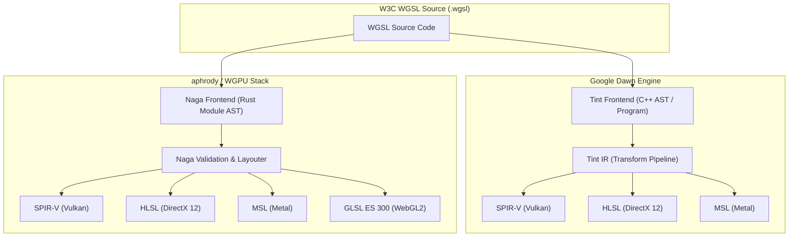

# Dawn & Cross-Backend Compilation Matrix

This reference documents the differences between Google Dawn / Tint and gfx-rs WGPU / Naga, cross-compilation target requirements, and Chromium headless WebGPU execution parameters.

---

## 1. Engine Comparison: Dawn/Tint vs. WGPU/Naga

WebGPU has two primary open-source implementations:
1. **Google Dawn** (written in C++20): Used in Google Chromium, Google Chrome, Android, and Node.js WebGPU implementations. Its WGSL parser and compiler is **Tint**.
2. **gfx-rs WGPU** (written in Rust): Used in Firefox, Servo, Zed / `aphrody`, Deno, and native Rust applications. Its WGSL parser and cross-compiler is **Naga**.



### Architectural Comparison Matrix

| Dimension | Google Dawn / Tint | gfx-rs WGPU / Naga |
| :--- | :--- | :--- |
| **Language** | C++20 | Rust (Safe memory, zero C++ runtime dependencies) |
| **Target Platforms** | Chromium, Android, Windows, macOS, Linux | Native desktop (Windows, macOS, Linux, iOS, Android), WASM |
| **WGSL Spec Conformance** | Normative upstream reference (Chrome team) | Strict W3C compliance + Naga-specific bounds check policies |
| **Intermediate Representation** | Tint AST $\rightarrow$ Tint IR | Naga `Module` (single-pass typed DAG with Arena indexing) |
| **Cross-Compilation Targets** | SPIR-V, HLSL, MSL, WGSL | SPIR-V, HLSL, MSL, WGSL, GLSL (Desktop & ES 3.00) |
| **Bounds Check Policies** | Dynamic clamp / zero-extension | Configurable: `Restrict`, `ReadZeroSkipWrite`, `Unchecked` |
| **Dual-Source Blending** | `enable dual_source_blending;` | `enable dual_source_blending;` (checked with `Capabilities`) |
| **Subgroup Support** | Full W3C subgroup operations | Full W3C subgroup operations |
| **aphrody CLI Tool** | `tint` (`PATH`) | `naga` & `gpui-wgpu` (`PATH` or `target/{debug,release}/gpui-wgpu`) |

---

## 2. Cross-Backend Target Specifications

### 1. SPIR-V (Vulkan)
- **SPIR-V Version**: 1.3 (default for WebGPU), 1.4, or 1.5.
- **Coordinate Space**: Normalized Device Coordinates (NDC) use $Y$-down in Vulkan by default. Naga and Tint insert viewport flips or coordinate transformations unless disabled.
- **Push Constants vs Uniforms**: Vulkan maps small uniform blocks or immediate constants to push constants when requested.

### 2. HLSL (DirectX 12)
- **Shader Model**: SM 6.0 (DXIL via DXC), SM 6.2 (16-bit float/int), SM 6.6 (DirectX raytracing and 64-bit atomics).
- **Binding Spaces**:
  - Constant Buffer Views (CBVs): `register(bN, spaceM)`.
  - Shader Resource Views (SRVs): `register(tN, spaceM)`.
  - Unordered Access Views (UAVs): `register(uN, spaceM)`.
  - Samplers: `register(sN, spaceM)`.
  Where `spaceM` corresponds directly to WGSL `@group(M)`.

### 3. Metal Shading Language (MSL / Apple Silicon)
- **MSL Versions**: MSL 1.2 (iOS legacy), 2.0 (macOS 10.14+), 2.3 (Metal ray tracing), 3.0 (Metal 3 mesh shaders).
- **Argument Buffers**: Metal maps `@group(M)` to argument buffer structures (`[[buffer(M)]]`), providing native zero-overhead binding tables.

### 4. GLSL ES 3.00 (WebGL 2.0 Fallback)
- **Precision Qualifiers**: Naga inserts `precision highp float; precision highp int;` headers.
- **Combined Samplers**: WebGL2 requires texture and sampler objects to be bound as combined pairs (`sampler2D`). Naga automatically reconstructs combined samplers from separate WGSL texture and sampler bindings.

---

## 3. Chromium Headless WebGPU Execution Parameters

When running automated headless WebGPU tests or benchmarks in Chromium / Chrome:

### Recommended CLI Flags
```powershell
chrome.exe `
  --headless=new `
  --use-angle=vulkan `
  --enable-unsafe-webgpu `
  --enable-features=Vulkan,DefaultANGLEVulkan,VulkanFromANGLE `
  --disable-gpu-sandbox `
  --disable-software-rasterizer `
  https://example.com/webgpu_test
```

### Flag Breakdown
- `--enable-unsafe-webgpu`: Enables WebGPU even when run in headless environments or on GPUs that are not explicitly allowlisted by Chrome.
- `--use-angle=vulkan`: Forces ANGLE to use the Vulkan graphics backend, matching native Vulkan behavior.
- `--headless=new`: Modern Chrome headless mode supporting hardware GPU acceleration and full WebGL/WebGPU surface presentation.

---

## 4. CLI Tooling Matrix in `aphrody`

| CLI Binary | Discovery / Location | Primary Purpose |
| :--- | :--- | :--- |
| **`gpui-wgpu`** | `PATH` or `target/{debug,release}/gpui-wgpu` | Multi-adapter diagnostic, shader validation, cross-compilation, headless rendering to PNG, compute dispatch, Criterion GPU benchmarks |
| **`naga`** | `PATH` | Direct Naga CLI compiler. Translates `.wgsl` to `.spv`, `.hlsl`, `.metal`, `.glsl` with custom bounds check policies |
| **`tint`** | `PATH` | Official Google Dawn WGSL validator and cross-compiler (`tint --parse-only true`) |
| **`tint_info`** | `PATH` | Dumps Dawn reflection data, bindings, and workgroup metadata |
| **`wgsl-analyzer`** | `PATH` | Fast WGSL language server, AST diagnostics, and symbol indexing |
| **`bun`** | `PATH` | Zero-dependency TypeScript runner and typechecker (`bun check`) with `@webgpu/types` |
