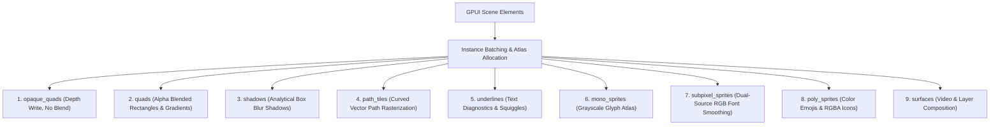
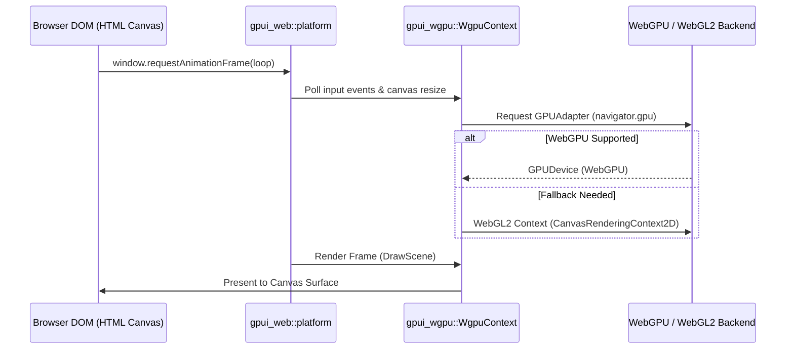

# GPUI WGPU & Web Rendering Pipeline Architecture

This reference documents the 2D vector UI rendering pipeline implemented in `crates/gpui_wgpu` and its browser WebGPU / WebGL2 platform counterpart in `crates/gpui_web`.

---

## 1. The 9 GPUI Render Pipelines

GPUI translates high-level UI component trees into flat draw command batches. In `crates/gpui_wgpu/src/wgpu_renderer.rs`, rendering is executed across **9 specialized `wgpu::RenderPipeline` instances**:



### Pipeline Catalog & Characteristics

| Pipeline | Target Element | WGSL Shader Entry Points | Blend State | Depth Write |
| :--- | :--- | :--- | :--- | :--- |
| `opaque_quads` | Solid color rectangles, background fills | `vs_quad`, `fs_opaque_quad` | None (Direct overwrite) | `true` |
| `quads` | Transparent rectangles, rounded corners, borders, gradients | `vs_quad`, `fs_quad` | Premultiplied Alpha | `false` |
| `shadows` | Inset & drop shadows with analytical blur radii | `vs_shadow`, `fs_shadow` | Premultiplied Alpha | `false` |
| `path_tiles` | Vector curve tiles (cubic Bezier paths) | `vs_path_tile`, `fs_path_tile` | Premultiplied Alpha | `false` |
| `underlines` | Text underlines (solid, wavy, dashed, error squiggles) | `vs_underline`, `fs_underline` | Premultiplied Alpha | `false` |
| `mono_sprites` | Monochromatic text glyphs & icons | `vs_mono_sprite`, `fs_mono_sprite` | Premultiplied Alpha | `false` |
| `subpixel_sprites` | Subpixel LCD antialiased text | `vs_subpixel_sprite`, `fs_subpixel_sprite` | Dual-Source Blend (`Src1`, `OneMinusSrc1`) | `false` |
| `poly_sprites` | Multichannel RGBA sprites (emojis, images) | `vs_poly_sprite`, `fs_poly_sprite` | Premultiplied Alpha | `false` |
| `surfaces` | Hardware video planes, offscreen render textures | `vs_surface`, `fs_surface` | Premultiplied Alpha | `false` |

---

## 2. Reverse-Z Depth Projection Architecture

GPUI draws thousands of overlapping UI rects, borders, shadows, and text characters per frame. Standard depth buffers $[0.0, 1.0]$ suffer from exponential loss of precision near the far plane. GPUI utilizes **Reverse-Z** depth mapping:

### Technical Parameters
- **Depth Texture Format**: `wgpu::TextureFormat::Depth32Float` (`DEPTH_FORMAT`).
- **Clear Value**: `0.0`.
- **Near Plane (top-most elements)**: $Z = 1.0$.
- **Far Plane (background canvas)**: $Z = 0.0$.
- **Depth Comparison**: `wgpu::CompareFunction::GreaterEqual`.
- **Depth Bias / Scale**:
  Each layer receives a monotonic draw order $N$. The vertex shader calculates:
  $$Z_{\text{device}} = \text{order} \times \text{depth\_scale}$$
  where `depth_scale` distributes integers $0 \le N \le 16{,}777{,}216$ across the high-precision $[0.0, 1.0]$ 32-bit float range.

### Architectural Benefits
1. Eliminates Z-fighting between closely stacked panels, modal backdrops, and borders.
2. Allows `opaque_quads` to write to the depth buffer first with depth testing enabled, enabling hardware early-Z cull for all occluded background pixels.

---

## 3. Oklab Gradient Interpolation

Colors defined in CSS sRGB space produce dark, desaturated bands ("muddy grays") when linearly interpolated across gradients. GPUI implements Oklab perceptual color space blending inside `crates/gpui_wgpu/src/shaders.wgsl`:

### The Conversion Math
1. **sRGB to Linear RGB**:
   $$C_{\text{linear}} = \begin{cases} \frac{C_{\text{srgb}}}{12.92} & C_{\text{srgb}} \le 0.04045 \\ \left(\frac{C_{\text{srgb}} + 0.055}{1.055}\right)^{2.4} & C_{\text{srgb}} > 0.04045 \end{cases}$$
2. **Linear RGB to LMS**:
   $$\begin{bmatrix} L \\ M \\ S \end{bmatrix} = \mathbf{M}_1 \begin{bmatrix} R \\ G \\ B \end{bmatrix}$$
3. **LMS to Oklab**:
   $$L' = L^{1/3}, \quad M' = M^{1/3}, \quad S' = S^{1/3}$$
   $$\begin{bmatrix} L_{\text{ok}} \\ a_{\text{ok}} \\ b_{\text{ok}} \end{bmatrix} = \mathbf{M}_2 \begin{bmatrix} L' \\ M' \\ S' \end{bmatrix}$$
4. In the fragment shader, stop colors are transformed to Oklab, smoothly interpolated along the gradient axis, and converted back to linear sRGB before writing to the render target.

---

## 4. Subpixel Glyph Rendering & Gamma Enhancement

Text rendering in `shaders_subpixel.wgsl` combines dual-source blending with display gamma correction:

### Gamma & Contrast Calculation
```wgsl
fn apply_contrast_and_gamma_correction3(
    coverage: vec3<f32>,
    color: vec3<f32>,
    enhanced_contrast: f32,
    gamma_ratios: vec3<f32>,
) -> vec3<f32> {
    // 1. Contrast expansion
    var c = pow(coverage, vec3f(enhanced_contrast));
    // 2. Luminance-dependent gamma correction
    c = c * gamma_ratios;
    return clamp(c, vec3f(0.0), vec3f(1.0));
}
```
If the display has a BGR subpixel strip instead of standard RGB, `gamma_params.is_bgr != 0u` swizzles `coverage.rgb` to `coverage.bgr` prior to filtering.

---

## 5. `WgpuHeadlessRenderer` for Offscreen Testing & CI

For testing without an active windowing system (e.g. CI environments, Criterion benchmarks), `crates/gpui_wgpu/src/wgpu_renderer.rs` provides `WgpuHeadlessRenderer`:

```rust
let (device, queue) = ...;
let mut renderer = WgpuHeadlessRenderer::new(
    device.clone(),
    queue.clone(),
    size,
    scale_factor,
);

// Render scene
renderer.draw(&scene);

// Read back unpadded pixels
let pixels: Vec<u8> = renderer.read_to_cpu();
```

### Headless Buffer Readback Pattern
To copy the rendered offscreen texture to CPU memory, `WgpuHeadlessRenderer` allocates a staging buffer with `wgpu::BufferUsages::MAP_READ | wgpu::BufferUsages::COPY_DST`:
```rust
let bytes_per_row = (width * 4 + 255) & !255; // 256-byte alignment
encoder.copy_texture_to_buffer(
    texture.as_image_copy(),
    wgpu::TexelCopyBufferInfo {
        buffer: &staging_buffer,
        layout: wgpu::TexelCopyBufferLayout {
            offset: 0,
            bytes_per_row: Some(bytes_per_row),
            rows_per_image: Some(height),
        },
    },
    wgpu::Extent3d { width, height, depth_or_array_layers: 1 },
);
```

---

## 6. `gpui_web` Browser Platform Architecture

In `crates/gpui_web`, GPUI compiles to WebAssembly (`wasm32-unknown-unknown`) and binds to an `HtmlCanvasElement`:



### Web Backend Selection
Applications configure browser backend fallback using `WebBackendPreference`:
- `WebBackendPreference::Auto` (default): Attempts `wgpu::Backends::BROWSER_WEBGPU`; if unavailable, falls back gracefully to `wgpu::Backends::GL` (WebGL2).
- `WebBackendPreference::WebGpu`: Forces native browser WebGPU.
- `WebBackendPreference::WebGl`: Forces WebGL 2.0 with data texture instance decoding.
