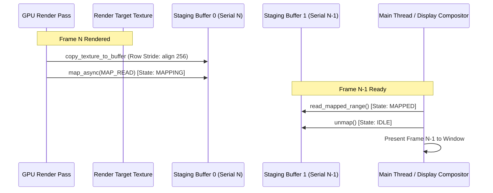

# NSH Custom Shader Architecture (`nsh-core` & `nsh-engine`)

This reference details the custom WGSL shader execution system used across Native Shell (NSH) applications in `crates/nsh-core/src/shader.rs` and `crates/nsh-engine/src/shader.rs`.

---

## 1. User Authoring Contract

NSH enables UI views, layers, effects, and transitions to execute custom WGSL shaders on the GPU. Instead of writing boilerplate vertex shaders, binding layouts, and pipeline states, an application authors a single pure fragment function:

```wgsl
fn shade(uv: vec2f) -> vec4f {
    // Return straight sRGB color with straight alpha (not premultiplied)
    return vec4f(uv.x, uv.y, 0.5 + 0.5 * sin(nsh.time), 1.0);
}
```

### Coordinate Space & Color Semantics
1. **`uv: vec2f`**:
   - Normalized box coordinates: $(0.0, 0.0)$ at top-left corner, $(1.0, 1.0)$ at bottom-right corner (matching CSS layout coordinates).
   - If `nsh.overflow` is non-zero, `uv` extends beyond $[0, 1]$ from $-\text{overflow} / \text{size}$ to $1 + \text{overflow} / \text{size}$.
2. **Color Output (`vec4f`)**:
   - Straight sRGB with alpha: $[r, g, b, a]$ where $r, g, b \in [0.0, 1.0]$ are un-premultiplied.
   - The NSH wrapper fragment shader automatically premultiplies alpha:
     $$\text{out.color} = \text{vec4f}(c.rgb \times c.a, c.a)$$

---

## 2. NSH Builtin Environment & Uniform Bindings

The compiler automatically wraps the user function with standard headers and entry points:


### Generated Bindings Layout (`@group(0)`)

| Binding | Resource | Type | Purpose |
| :--- | :--- | :--- | :--- |
| `@binding(0)` | `var<uniform> nsh: Nsh` | Uniform Buffer (32 bytes) | View dimensions, clock, scale factor, transition progress, overflow |
| `@binding(1)` | `var<uniform> uniforms: Uniforms` | Uniform Buffer (optional) | User-defined custom uniform struct (up to 4096 bytes) |
| `@binding(2)` | `var nsh_sampler: sampler` | Filtering Sampler | Bilinear sampler for input content and backdrop textures |
| `@binding(3)` | `var nsh_content: texture_2d<f32>` | Sampled Texture 2D | Child content texture (`sample_content(uv)`) |
| `@binding(4)` | `var nsh_backdrop: texture_2d<f32>` | Sampled Texture 2D | Backdrop behind the view (`sample_backdrop(uv)`) |
| `@binding(5)` | `var nsh_from: texture_2d<f32>` | Sampled Texture 2D | Transition origin page (`sample_from(uv)`) |
| `@binding(6)` | `var nsh_to: texture_2d<f32>` | Sampled Texture 2D | Transition target page (`sample_to(uv)`) |

### The `Nsh` Builtin Struct (32 Bytes Padded)
```wgsl
struct Nsh {
    size: vec2f,          // View size in points (e.g. 400.0, 300.0)
    time: f32,            // Monotonic elapsed time in seconds
    scale: f32,           // Pixels per point (DPI scaling factor)
    progress: f32,        // Effect progress or transition interpolation (0.0..1.0)
    @size(12) overflow: f32, // Padding to ensure 32-byte 16-byte alignment
}
@group(0) @binding(0) var<uniform> nsh: Nsh;
```

---

## 3. Naga Validation & Reflection Rules

Before compiling to GPU bytecode, `nsh-core` validates the user source in Rust:
1. **Source Length**: `MAX_SOURCE_BYTES = 64 * 1024` (64 KiB maximum).
2. **Restricted Declarations**:
   - The user source **must not** declare entry points (`@vertex`, `@fragment`, `@compute`).
   - The user source **must not** declare `@group` or `@binding` variables.
   - User globals must be declared only as `var<private>`.
3. **Uniform Struct Bounds**:
   - If declared, `struct Uniforms` must take at most `MAX_UNIFORM_BYTES = 4096` bytes.
   - Uniform members must be valid scalar numbers, vectors of `f32`, or arrays of `vec4f`.
4. **Animated Slots**:
   - Uniforms marked with animated metadata (`UniformValue::Animated`) are reflected into slot indices. The platform updates these slots directly in the uniform buffer each frame without re-parsing WGSL or calling into JavaScript.

---

## 4. Double-Buffered `MAP_READ` Staging Pipeline

On Windows and Linux native backends, rendered frames must be transferred from the GPU texture to CPU memory for UI composition or IPC streaming without causing pipeline stalls:



### Staging Buffer Lifecycle States
In `crates/nsh-engine/src/shader.rs`:
```rust
mod state {
    pub const IDLE: u8 = 0;    // Ready for new copy submission
    pub const MAPPING: u8 = 1; // Map request queued on GPU
    pub const MAPPED: u8 = 2;  // Memory accessible by CPU
    pub const FAILED: u8 = 3;  // Device lost or mapping error
}

struct Readback {
    buffer: wgpu::Buffer,
    state: Arc<AtomicU8>,
    serial: u64,
}

struct Target {
    width: u32,
    height: u32,
    stride: u32, // (width * 4).next_multiple_of(256)
    view: wgpu::TextureView,
    texture: wgpu::Texture,
    readbacks: [Readback; 2], // Ping-pong double buffers
}
```
By alternating between two staging buffers (`[Readback; 2]`), the GPU writes frame $N$ to Buffer 0 while the CPU reads frame $N-1$ from Buffer 1, achieving maximum throughput with zero CPU pipeline bubbles.

---

## 5. Apple `IOSurface` Zero-Copy Presentation

On macOS platforms (`#[cfg(target_vendor = "apple")]`), double-buffered CPU readbacks are completely bypassed:
- NSH allocates an `IOSurface` backed texture.
- The GPU renders directly into the `IOSurface`.
- The surface is bound directly to CoreAnimation / Metal layers without any CPU memory copy (`crates/nsh-engine/src/shader_surfaces.rs`).

---

## 6. GLSL ES 300 Transpilation for WebGL2

When compiling NSH views for web browsers running WebGL2:
1. `nsh-core` calls `Shader::glsl_es()`.
2. Naga's `glsl::Writer` translates the wrapped WGSL AST into GLSL ES 3.00:
   - Builtin uniforms are mapped to uniform blocks (`layout(std140)`).
   - Samplers and textures are transformed into GLSL combined texture samplers (`sampler2D`).
   - Vertex coordinates are converted from WebGPU $[0, 1]$ $Z$-range to OpenGL $[-1, 1]$ clip space.
