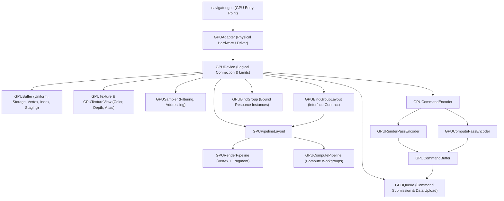

# W3C WebGPU & WGSL Specification Reference

This document details the normative W3C WebGPU API and WGSL (WebGPU Shading Language) specification standards implemented across `aphrody`, `vendor/wgpu` (v30.0.0), and Google Dawn.

---

## 1. W3C WebGPU Object Model

WebGPU exposes a stateless, multithread-capable interface designed to align with modern native graphics APIs (Vulkan, DirectX 12, and Metal) while enforcing browser memory safety.



### Core Object Responsibilities

1. **`GPU` / `Instance`**:
   - Web: `navigator.gpu`.
   - Native: `wgpu::Instance::new(desc)`. Creates instances across selected backends (`Vulkan`, `DX12`, `Metal`, `GL`, `BrowserWebGpu`).
2. **`GPUAdapter`**:
   - Represents a physical GPU or software rasterizer (WARP / SwiftShader).
   - Reports `AdapterInfo` (vendor ID, device ID, driver name, backend architecture), `Limits`, and `Features`.
3. **`GPUDevice`**:
   - The primary resource allocator. Creates buffers, textures, samplers, pipelines, and command encoders.
   - Manages error scopes (`pushErrorScope`, `popErrorScope`) and device loss handling (`lost.then(...)`).
4. **`GPUQueue`**:
   - The submission queue for GPU commands (`queue.submit([commandBuffer])`).
   - Handles fast-path writes: `queue.writeBuffer(...)` and `queue.writeTexture(...)`.
5. **`GPUBuffer` & `GPUTexture`**:
   - Linear memory buffers with explicit usages (`MAP_READ`, `MAP_WRITE`, `COPY_SRC`, `COPY_DST`, `UNIFORM`, `STORAGE`, `VERTEX`, `INDEX`, `INDIRECT`).
   - Dimensional textures (1D, 2D, 3D, 2D array, Cube) with formats conforming to WebGPU texture capabilities.
6. **`GPUBindGroup` & `GPUBindGroupLayout`**:
   - Separation of binding interface contract (`BindGroupLayout`) from concrete resource bindings (`BindGroup`).
   - Group numbering corresponds to WGSL `@group(N)` and bindings to `@binding(M)`.

---

## 2. WGSL Address Spaces & Access Modes

WGSL defines five explicit address spaces for variables:

| Address Space | Keyword | Scope | Access Mode | Backing Memory |
| :--- | :--- | :--- | :--- | :--- |
| **Function** | `function` | Local to function block | `read_write` | Private thread stack / registers |
| **Private** | `private` | Module-scope, per-invocation | `read_write` | Registers / thread-local scratchpad |
| **Workgroup** | `workgroup` | Module-scope, shared across workgroup | `read_write` | On-chip Shared Memory (L1 / LDS / TGSM) |
| **Uniform** | `uniform` | Module-scope, host-allocated buffer | `read` (constant cache) | Read-only constant buffer (CBV / Uniform) |
| **Storage** | `storage` | Module-scope, host-allocated buffer | `read` or `read_write` | Global VRAM (SSBO / UAV) |

### Declaration Syntax
```wgsl
var<function> local_var: f32 = 0.0;
var<private> invocation_accum: vec4f = vec4f(0.0);
var<workgroup> tile_cache: array<vec4f, 64>;
@group(0) @binding(0) var<uniform> uniforms: ViewUniforms;
@group(0) @binding(1) var<storage, read> input_data: array<f32>;
@group(0) @binding(2) var<storage, read_write> output_data: array<f32>;
```

---

## 3. Host-Shareable Alignment and Layout Rules

Memory shared between CPU and GPU (`uniform` and `storage` address spaces) must obey deterministic memory layout rules.

### Standard WGSL Alignment & Size Table

| Type | Size (Bytes) | Alignment (Bytes) | Notes |
| :--- | :--- | :--- | :--- |
| `bool` | 4 | 4 | In host-shareable memory, booleans use 32-bit integers (`u32`) |
| `i32`, `u32`, `f32` | 4 | 4 | Standard 32-bit scalar |
| `f16` | 2 | 2 | Requires `enable f16;` extension |
| `vec2<T>` | $2 \times \text{size}(T)$ | $2 \times \text{align}(T)$ | `vec2f` = 8 bytes size, 8 bytes align |
| `vec3<T>` | $3 \times \text{size}(T)$ | $4 \times \text{align}(T)$ | **`vec3f` = 12 bytes size, 16 bytes align!** |
| `vec4<T>` | $4 \times \text{size}(T)$ | $4 \times \text{align}(T)$ | `vec4f` = 16 bytes size, 16 bytes align |
| `mat2x2<f32>` | 16 | 8 | Array of 2 `vec2f` |
| `mat3x3<f32>` | 48 | 16 | Array of 3 `vec3f` (each padded to 16 bytes) |
| `mat4x4<f32>` | 64 | 16 | Array of 4 `vec4f` |
| `array<T, N>` | $N \times \text{stride}(T)$ | $\text{align}(T)$ | $\text{stride}(T) = \text{align\_to}(\text{size}(T), \text{align}(T))$ |
| `struct S` | Sum of offsets + padding | $\max(\text{align}(\text{member}))$ | Padded to multiple of struct alignment |

### The `vec3<f32>` Trap
In Rust, `[f32; 3]` has alignment 4 and size 12. In WGSL, `vec3<f32>` has **alignment 16 and size 12**:
```wgsl
// WGSL Layout:
struct BadStruct {
    a: f32,       // offset 0, size 4
    // 12 bytes padding inserted here because vec3f requires 16-byte alignment!
    b: vec3<f32>, // offset 16, size 12
    c: f32,       // offset 28, size 4
} // total size = 32 bytes

// Rust #[repr(C)] counterpart without explicit padding will mismatch!
```
**Rule in `aphrody`**: Always use `vec4<f32>` instead of `vec3<f32>`, or insert explicit `_pad: f32` fields to guarantee memory alignment matches between Rust `bytemuck` types and WGSL.

### Uniform Struct 16-Byte Padding Rule
In WebGPU / WGSL:
- Uniform buffers must have dynamic and binding offsets that are multiples of `minUniformBufferOffsetAlignment` (typically 256 bytes).
- All structures in `var<uniform>` must have a total byte length that is a multiple of **16 bytes**.
- Platforms lacking `BUFFER_BINDINGS_NOT_16_BYTE_ALIGNED` (including WebGL2 fallback backends) reject uniform buffers whose bound size is not a multiple of 16.

### Row Stride 256-Byte Alignment (`COPY_BYTES_PER_ROW_ALIGNMENT`)
When issuing texture-to-buffer copies:
```rust
encoder.copy_texture_to_buffer(
    wgpu::TexelCopyTextureInfo {
        texture: &texture,
        mip_level: 0,
        origin: wgpu::Origin3d::ZERO,
        aspect: wgpu::TextureAspect::All,
    },
    wgpu::TexelCopyBufferInfo {
        buffer: &staging_buffer,
        layout: wgpu::TexelCopyBufferLayout {
            offset: 0,
            bytes_per_row: Some(bytes_per_row), // MUST be a multiple of 256
            rows_per_image: Some(height),
        },
    },
    wgpu::Extent3d { width, height, depth_or_array_layers: 1 },
);
```
Formula for `bytes_per_row`:
```rust
let unaligned_bytes = width * 4; // 4 bytes for RGBA8
let bytes_per_row = (unaligned_bytes + 255) & !255;
```

---

## 4. Uniformity Analysis in WGSL

WGSL enforces static uniformity analysis to prevent undefined behavior on hardware where divergent threads execute collective operations:

1. **Derivative Uniformity**:
   Functions `dpdx()`, `dpdy()`, `fwidth()`, and implicit LOD texture sampling (`textureSample()`) compute finite differences using quad fragments ($2 \times 2$ pixel neighborhoods). They **must** be called in uniform control flow. Calling them inside dynamic `if` branches or non-uniform loops produces a compile-time Naga/Dawn error:
   ```wgsl
   // ERROR: Calling derivative function in non-uniform control flow
   if (input.clip_distances.x < 0.0) {
       let d = dpdx(input.uv); // Naga rejects: non-uniform derivative
   }

   // CORRECT (GPUI Pattern): Compute derivatives / samples before conditional discard:
   let sample = textureSample(t_atlas, s_atlas, input.tile_position);
   if (any(input.clip_distances < vec4f(0.0))) {
       discard;
   }
   ```
2. **Workgroup Barriers**:
   `workgroupBarrier()` and `storageBarrier()` must be reached by all invocations in the workgroup simultaneously. If placed inside a conditional branch, the condition must evaluate uniformly across all invocations.

---

## 5. Dual-Source Blending (`dual_source_blending`)

Subpixel text antialiasing calculates independent horizontal coverage values for the red, green, and blue subpixel elements of LCD displays. Standard hardware blending only allows a single alpha scalar from output 0. Dual-source blending allows a fragment shader to emit two outputs to location 0:
- Output 0 (`@blend_src(0)`): Premultiplied foreground color.
- Output 1 (`@blend_src(1)`): Per-channel RGB coverage mask.

### WGSL Shader Declaration
```wgsl
enable dual_source_blending;

struct SubpixelOutput {
    @location(0) @blend_src(0) color: vec4<f32>,
    @location(0) @blend_src(1) mask: vec4<f32>,
}

@fragment
fn fs_subpixel(in: VertexOutput) -> SubpixelOutput {
    let font_rgb_coverage = textureSample(t_glyph, s_glyph, in.uv).rgb;
    var out: SubpixelOutput;
    out.color = vec4f(in.color.rgb, 1.0);
    out.mask = vec4f(in.color.a * font_rgb_coverage, 1.0);
    return out;
}
```

### Pipeline Blend State Configuration
```rust
wgpu::ColorTargetState {
    format,
    blend: Some(wgpu::BlendState {
        color: wgpu::BlendComponent {
            src_factor: wgpu::BlendFactor::Src1,
            dst_factor: wgpu::BlendFactor::OneMinusSrc1,
            operation: wgpu::BlendOperation::Add,
        },
        alpha: wgpu::BlendComponent {
            src_factor: wgpu::BlendFactor::One,
            dst_factor: wgpu::BlendFactor::OneMinusSrcAlpha,
            operation: wgpu::BlendOperation::Add,
        },
    }),
    write_mask: wgpu::ColorWrites::ALL,
}
```

---

## 6. Subgroups (`subgroups`)

The WebGPU subgroups extension enables SIMD communication across invocations in the same hardware warp (NVIDIA: 32 threads) or wavefront (AMD: 32/64 threads; Intel: 8/16/32 threads; Apple: 32 threads) without going through workgroup shared memory:

```wgsl
enable subgroups;

@compute @workgroup_size(64)
fn cs_subgroup_reduce(@builtin(subgroup_invocation_id) lane_id: u32) {
    let value = calculate_work(lane_id);
    let subgroup_sum = subgroupAdd(value);
    let subgroup_any = subgroupAny(value > 100.0);
    let ballot = subgroupBallot(value > 0.0);
}
```

---

## 7. WebGPU vs. WebGL2 Fallback Matrix

When running in browsers lacking WebGPU, `aphrody` via `crates/gpui_web` and `crates/gpui_wgpu` falls back to WebGL 2.0 (via `wgpu` GLES backend):

| Feature | Browser WebGPU | WebGL 2.0 Fallback |
| :--- | :--- | :--- |
| **Shading Language** | WGSL (native) | GLSL ES 3.00 (transpiled by Naga) |
| **Instance Data Transport** | Storage buffers (`b_quads: array<Quad>`) | Data Texture Fetch (`t_instances: texture_2d<f32>`) |
| **Subpixel Text Antialiasing** | Supported via `dual_source_blending` | Disabled (falls back to monochrome glyphs) |
| **Depth Buffer Precision** | Reverse-Z (`0.0..1.0` depth range) | Transformed to OpenGL $[-1.0, 1.0]$ clip space |
| **Compute Shaders** | Full WebGPU compute passes | Not supported in WebGL 2.0 |
| **Bind Group Uniform Offsets** | Strict 256-byte alignment | Strict 256-byte alignment |
