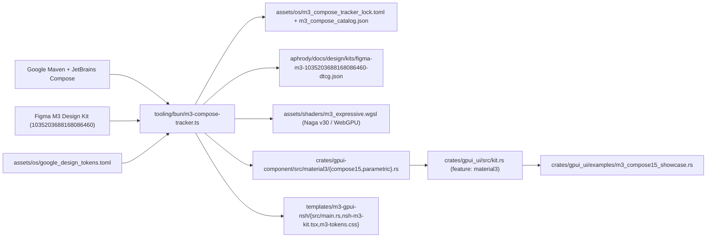

# Compose Material 3 1.5.0 Stable, Parametric Prototyping & Figma Design Kit -> GPUI / GPUI Kit / NSH / WGPU

> End-to-end verified design system, automatic upstream tracker, and multi-target converter bridging Google's **Compose Material 3 `1.5.0` Stable** (`2026-11-18`, `compose-bom:2026.11.01`), **Parametric Prototyping** (`2026-11-16`), and the official **Material 3 Figma Design Kit** (`1035203688168086460`) directly into Aphrody's **WGPU/Naga v30 shaders**, **GPUI Kit**, and **Native Shell (NSH)**.

## 1. Authoritative Upstream Sources

- **Compose Material 3 `1.5.0` Stable**: `https://m3.material.io/blog/compose-material-3-is-stable` (`https://developer.android.com/jetpack/androidx/releases/compose-material3#1.5.0`)
- **Material 3 Parametric Prototyping**: `https://m3.material.io/blog/enhance-your-component-designs-with-parametric-prototyping`
- **Official Material 3 Figma Design Kit**: `https://www.figma.com/community/file/1035203688168086460/material-3-design-kit`
- **Single Token Source of Truth**: [`assets/os/google_design_tokens.toml`](../../../assets/os/google_design_tokens.toml) + [`assets/os/m3_compose_tracker_lock.toml`](../../../assets/os/m3_compose_tracker_lock.toml)

## 2. End-to-End Architecture & Layering



## 3. Compose Material 3 `1.5.0` Stable -> GPUI Kit Coverage

| Compose Material 3 `1.5.0` API | GPU WGSL (`m3_expressive.wgsl`) | GPUI Kit (`gpui_ui::kit`) | NSH (`templates/m3-gpui-nsh/nsh-m3-kit.tsx`) |
| --- | --- | --- | --- |
| `MaterialExpressiveTheme` + `MotionScheme` | `ViewportUniform` + `M3Instance` | `M3ExpressiveThemeScope`, `M3MotionScheme` | `applyM3ExpressiveMode`, `M3_MOTION_SCHEMES` |
| `material3-ripple:1.5.0` Inset Focus Rings | `fs_main` inset ring SDF (`flags & 1`) | `M3RippleThemeConfig` | CSS / focus state tokens |
| `Typography(defaultFontFamily)` | — | `m3_typography_with_default_font_family` | `m3-tokens.css` |
| `ToggleButton` family (`ButtonSize`) | `widget_meta.x = 1` morph | `M3ToggleButton` (`Filled`/`Elevated`/`FilledTonal`/`Outlined`) | `M3ToggleButton` |
| `SplitButton` | `widget_meta.x = 5` | `M3SplitButton` | `M3SplitButton` |
| `ButtonGroup` (`compressionLimit` + overflow) | `widget_meta.x = 5` | `M3ButtonGroup` | `M3FloatingToolbar` / button group |
| `FloatingToolbar` / `HorizontalFloatingToolbar` | `widget_meta.x = 0` elevated pill | `M3FloatingToolbar` | `M3FloatingToolbar` |
| `WavyLinearProgressIndicator` / `WavyCircularProgressIndicator` | `sdf_wavy_linear` / `sdf_wavy_circular` | `M3WavyLinearProgressIndicator` / `M3WavyCircularProgressIndicator` | `m3_expressive.wgsl` + tokens |
| Segmented `ListItem` / `InteractiveListItem` | `widget_meta.x = 0` segmented | `M3SegmentedListItem` | `M3SegmentedListItem` |
| Stateful `Slider(SliderState)` / `RangeSlider(RangeSliderState)` | `widget_meta.x = 4` | `M3StatefulSlider` / `M3StatefulRangeSlider` | Parametric controls |
| Expressive `TextField` / `SecureTextField(System)` | `widget_meta.x = 0` cutout | `M3ExpressiveTextField` | NSH `Input` |
| `SelectableDropdownMenuItem` / `CheckableDropdownMenuItem` | `widget_meta.x = 0` | `M3ExpressiveMenuItem` + `M3PopupAnchor` | NSH `Menu` |
| `Scrim` + deterministic `BottomSheet` anchors | `widget_meta.x = 6` progressive blur | `M3Scrim` + `M3BottomSheetAnchor` | NSH overlays |
| `VibrantTimePickerDialog` + `ScrollField` | `widget_meta.x = 0 + 1` | `M3VibrantTimePicker` + `M3ScrollField` | Parametric target |
| `MaterialShapes` (35) + `LoadingIndicator` | `sdf_material_polygon` (35 shapes) | `M3MaterialShape::ALL_35` + `M3LoadingIndicator` | `MATERIAL_SHAPES_35` |

## 4. Parametric Prototyping Studio (All 6 Material 3 Strategies)

Implemented natively in [`crates/gpui-component/src/material3/parametric.rs`](../../../crates/gpui-component/src/material3/parametric.rs) and exposed via `gpui_ui::kit::M3ParametricPrototyperView`:

1. **Map the sweet spots**: `M3SweetSpotGrid::evaluate(mode)` classifies a 4x4 `(corner_radius_px x container_height_px)` grid into `SweetSpot`, `Caution`, and `OffLimits` using touch-target minimums, 50%-height radius clamping, and WCAG 2.2 AA (`>= 4.5:1`) contrast.
2. **Fine-tune parameters**: `M3ParametricVariables` decouples corner radius, padding, container height, typography size, wave geometry, polygon shape, appearance mode, and `M3MotionScheme` in Rust.
3. **Group & tether parameters**: `M3ParamTetherRules` couples corner radius to `<= 0.5 * container_height_px` and horizontal padding proportionally to height.
4. **Turn designs into specs**: `M3SpecOverlayConfig` toggles live keylines, semantic color token readouts, and spatial measurement badges directly over the stage.
5. **Presets & JSON / Figma DTCG export**: `M3ParamPreset::built_in_presets()`, `export_preset_json`, `import_preset_json`, and `export_figma_dtcg_json` anchored to Figma Community file `1035203688168086460`.
6. **Randomize to break patterns**: Deterministic SplitMix64 `M3ParametricState::randomize(seed)`.

## 5. Reproducible Commands & Scheduled Automation

```sh
# 1. Refresh upstream Compose Material 3 Maven lockfile
bun run m3:track

# 2. Deterministically convert specs/tokens to GPU WGSL, GPUI Kit, NSH TSX, Figma DTCG & starter template
bun run m3:convert

# 3. Run full end-to-end automated proof suite (writes target/m3-gpui-proof.json)
bun run m3:prove

# 4. Launch native GPUI Kit + Parametric Prototyping showcase
cargo run -p gpui_ui --features material3 --example m3_compose15_showcase
```

Daily scheduled tracking and PR generation runs via [`.github/workflows/aphrody-m3-compose-tracker.yml`](../../../.github/workflows/aphrody-m3-compose-tracker.yml).
