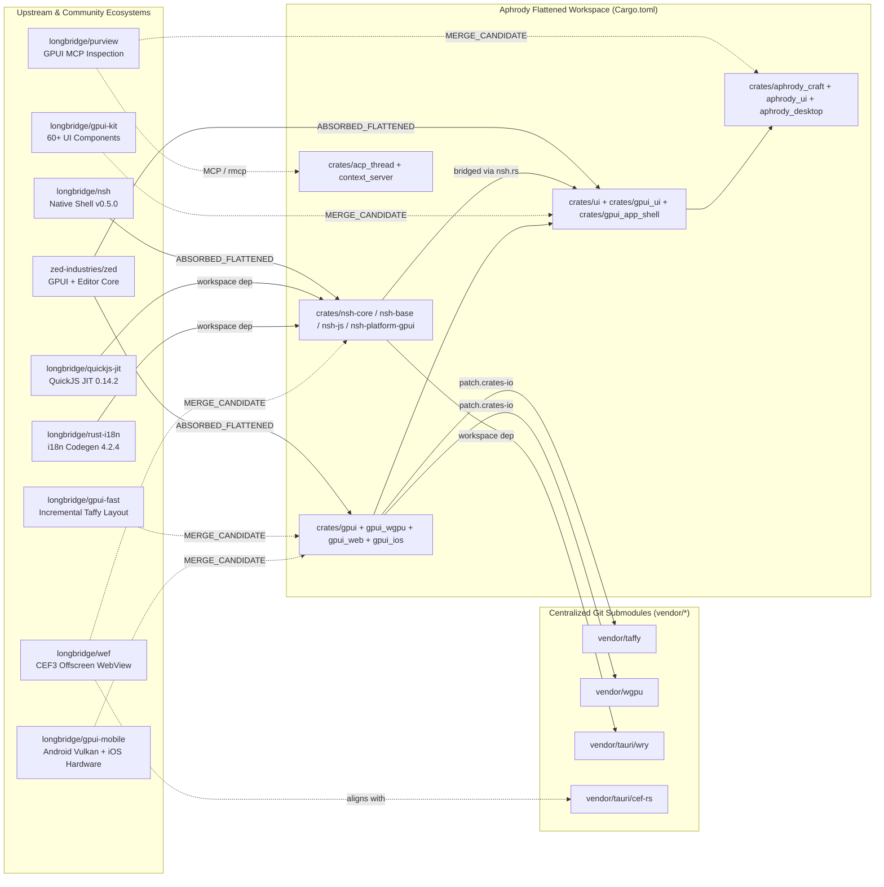

# Longbridge, Zed & Community GPUI Unification Architecture

> Canonical, reproducible deduplication, dependency centralization, Graphify topology, feature-matrix audit, and live ecosystem verification for unifying upstream `zed-industries/zed`, `longbridge` GPUI/NSH repositories, Kitesurf absorbed forks, and community GPUI crates onto the flattened [`aphrody`](../../../Cargo.toml) core.

---

## 1. Automated Ingestion & Verification Pipeline

All telemetry in [`assets/os/longbridge_gpui_inventory.toml`](../../../assets/os/longbridge_gpui_inventory.toml), `target/longbridge-ingest/graph.json`, `target/longbridge-screenshots/*.png`, and the synchronized sections below is generated by [`tooling/bun/longbridge-ingest.ts`](../../../tooling/bun/longbridge-ingest.ts) and verified by [`tooling/bun/longbridge-ingest.test.ts`](../../../tooling/bun/longbridge-ingest.test.ts):

```bash
bun tooling/bun/longbridge-ingest.ts scan        # Live Longbridge (100+ repos) + Zed + Community GPUI + crates.io/npm scan
bun tooling/bun/longbridge-ingest.ts graph       # cargo metadata feature matrix + Graphify JSON + Mermaid + TOML inventory
bun tooling/bun/longbridge-ingest.ts centralize  # Workspace dependency, [lints], [patch.crates-io], and duplicate crate audit
bun tooling/bun/longbridge-ingest.ts sitemaps    # Live sitemap.xml + internal route crawler across GPUI/NSH/Zed docs
bun tooling/bun/longbridge-ingest.ts screenshots # Headless Chromium/Edge CDP PNG captures in target/longbridge-screenshots/
bun tooling/bun/longbridge-ingest.ts all         # Full end-to-end ingestion refresh
```

### Live Verified Telemetry Snapshot

<!-- BEGIN LONGBRIDGE_INGEST_METRICS -->
| Telemetry Dimension | Live Verified Count / Value | Source / Audit Path |
| :--- | :--- | :--- |
| **Longbridge Org Repos Scanned** | `103` repos (`5` absorbed, `12` merge candidates, `29` ref/bench/showcase, `57` infra) | `gh api --paginate orgs/longbridge/repos` |
| **Community GPUI Repos Tracked** | `22` repositories | GitHub Search + `crates.io` |
| **Aphrody Workspace Crates** | `301` members (`61` core GPUI/NSH/OS crates in feature matrix) | `cargo metadata --format-version 1` |
| **Cargo Dependency Centralization** | `63` non-workspace dep entries across `61` unique deps; `1` crates missing `[lints] workspace = true` | Root [`Cargo.toml`](../../../Cargo.toml) + member manifests |
| **Resolved Graph Duplicates** | `177` crates with >1 resolved version (`177` major.minor splits) | `target/longbridge-ingest/graph.json` |
| **Live Sitemaps & Screenshots** | `12` showcase/docs sites (`5987` discovered URLs), `6/6` validated PNG captures | `target/longbridge-screenshots/*.png` |
<!-- END LONGBRIDGE_INGEST_METRICS -->

---

## 2. Deduplicated Graphify Topology

<!-- BEGIN LONGBRIDGE_INGEST_MERMAID -->


> Graphify snapshot: **419** deduplicated nodes, **558** typed edges, **19** merge candidates, **177** multi-version crates (**177** major.minor splits).
<!-- END LONGBRIDGE_INGEST_MERMAID -->

---

## 3. Repository Classification & Deduplication Matrix

### 3.1 Absorbed & Unified Architecture (`ABSORBED_FLATTENED`)

| Upstream / Stack Layer | Local Aphrody Anchor | Integration & Centralization State |
| :--- | :--- | :--- |
| **Single Unified GPUI Core** (`zed-industries/zed` + `gpui-fast` retained invariants) | [`crates/gpui/Cargo.toml`](../../../crates/gpui/Cargo.toml), [`crates/gpui/src/gpui.rs`](../../../crates/gpui/src/gpui.rs), [`path_builder.rs`](../../../crates/gpui/src/path_builder.rs), [`window.rs`](../../../crates/gpui/src/window.rs), [`taffy.rs`](../../../crates/gpui/src/taffy.rs) | Single workspace `gpui` (`0.2.2`) with `Path<T = Pixels>` (`Path::translate`), 1-arg `Window::paint_layer`, and retained-mode invariants. Compatibility `default = ["gpui-fast"]` guards live in `gpui-base`/`gpui-component`/`gpui-kit` with `GPUI_FAST: bool = false` in [`crates/gpui-kit/src/lib.rs`](../../../crates/gpui-kit/src/lib.rs). |
| **Longbridge NSH `0.6.0` + M3 Kit** (`longbridge/nsh`, `native-shell-v1`) | [`crates/nsh-core/Cargo.toml`](../../../crates/nsh-core/Cargo.toml), [`crates/nsh-base/src/material3.rs`](../../../crates/nsh-base/src/material3.rs), [`crates/gpui_ui/src/nsh.rs`](../../../crates/gpui_ui/src/nsh.rs), [`crates/aphrody_nsh/src/material3_kit.rs`](../../../crates/aphrody_nsh/src/material3_kit.rs) | Flattened `crates/nsh-*` (`nsh-core`, `nsh-base`, `nsh-bundler`, `nsh-dev` at `0.6.0`), using `taffy::ScrollableOverflow::new` and `&self` `cache_get`. 4-mode Material 3 Expressive tokens (`M3Mode`, `M3_SPRINGS`) sync via `gpui_ui::nsh` and 12 `aphrody_nsh::material3_kit` builders + `export_m3_nsh_tsx_kit()`. |
| **Longbridge GPUI Kit `0.10.0` + M3 Kit** (`longbridge/gpui-kit`) | [`crates/gpui-kit/Cargo.toml`](../../../crates/gpui-kit/Cargo.toml), [`crates/gpui-component/Cargo.toml`](../../../crates/gpui-component/Cargo.toml), [`crates/gpui-base/Cargo.toml`](../../../crates/gpui-base/Cargo.toml), [`material3.rs`](../../../crates/gpui-component/src/material3.rs), [`crates/gpui_ui/src/kit.rs`](../../../crates/gpui_ui/src/kit.rs) | `gpui-kit`, `gpui-component`, `gpui-base`, `gpui-component-macros`, and `gpui-kit-assets` unified at `0.10.0` on single `gpui` + `lsp_types_kit = "0.97"` (`proposed`). Includes 4-mode M3 Expressive tokens (`M3AppearanceMode`, `M3SpringToken`) and 16 `RenderOnce` widgets re-exported via `gpui_kit::material3`. |
| **Layout & GPU Primitives** (`taffy 0.15.1` + `wgpu v30`) | [`vendor/taffy/Cargo.toml`](../../../vendor/taffy/Cargo.toml), [`vendor/wgpu/Cargo.toml`](../../../vendor/wgpu/Cargo.toml), [`Cargo.toml`](../../../Cargo.toml) | `[patch.crates-io]` pins `taffy = "0.15.1"` (`vendor/taffy`, `flexbox_balance`, `detailed_layout_info`) and `wgpu` / `naga` `30.0.0` (`vendor/wgpu`) across desktop, headless Linux, and WebGPU/Wasm targets. |
| **Kitesurf Absorbed Forks & Browser Engine** | [`.gitmodules`](../../../.gitmodules), [`vendor/browser/docs/kitesurf.md`](../../../vendor/browser/docs/kitesurf.md), [`vendor/browser/third_party/README.md`](../../../vendor/browser/third_party/README.md), [`upstreams.toml`](../../../vendor/browser/tools/upstreams.toml) | Absorbs Kitesurf engine forks (`taffy`, `parley`, `stylo`, `blitz`, `vello`, `anyrender`, `boa`, `resvg`, `jpeg-encoder`, `ratatui-image`) across `vendor/*`, `Cargo.toml` (`resvg 0.46.0`), and `vendor/browser`. Heavy `vendor/browser/third_party` checkouts stay slimmed to gitlinks with `mode = "pin"` SHAs in `upstreams.lock.json`. |
| `longbridge/quickjs-jit` | [`Cargo.toml`](../../../Cargo.toml) (`rquickjs`, `quickjs-jit-stdlib`), `crates/nsh-js` | Centralized in `[workspace.dependencies]` (`quickjs-jit-sys` built at `opt-level = 3`). |
| `longbridge/rust-i18n` | [`Cargo.toml`](../../../Cargo.toml) (`rust-i18n`, `rust-i18n-support`), `crates/nsh-i18n` | Centralized in `[workspace.dependencies]`. |
| `longbridge/wry` | [`.gitmodules`](../../../.gitmodules) (`vendor/tauri/wry`), [`Cargo.toml`](../../../Cargo.toml) (`wry`) | Single path submodule checkout `vendor/tauri/wry` referenced via `[workspace.dependencies]`. |

### 3.2 Ongoing Convergence & Remaining Candidates (`MERGE_CANDIDATE`)

| Upstream / Community Repo | Target Aphrody Crates | Technical Gap & Merge Plan |
| :--- | :--- | :--- |
| `longbridge/gpui-mobile` | [`crates/gpui_ios/Cargo.toml`](../../../crates/gpui_ios/Cargo.toml), `crates/nsh-platform-android`, `crates/gpui_platform` | Port Android Vulkan surface lifecycle and unified mobile device/hardware features from `gpui-pre-mobile` onto centralized `gpui_platform`. |
| `longbridge/wef` | `crates/nsh-platform-gpui`, `vendor/tauri/cef-rs`, `crates/aphrody_desktop` | Evaluate offscreen CEF3 rendering (`wef 0.6.0`, `gpui-webview 0.10.0`) alongside `vendor/tauri/cef-rs` for consistent embedded web surfaces. |
| `longbridge/purview` | [`crates/aphrody_craft/src/mcp.rs`](../../../crates/aphrody_craft/src/mcp.rs), `crates/inspector_ui`, `crates/gpui_ui` | Adopt structured semantic multi-window GPUI projection over `rmcp` so AI agents inspect and drive live GPUI windows alongside `aphrody_pilot`. |
| `longbridge/longbridge-ai-acp` & `acp-registry` | `crates/acp_thread`, `crates/acp_tools`, `crates/agent_servers` | Align ACP auth/rich-content contracts with root `agent-client-protocol`. |
| `longbridge/longbridge-mcp` & `longbridge-terminal` | `crates/aphrody_craft`, `crates/context_server`, `crates/terminal_view`, `crates/nsh-platform-tui` | Harmonize streamable-HTTP `rmcp` servers and Ratatui/CLI release packaging profiles. |
| Community GPUI Libs (`gpui-ce`, `gpui-motion`, `gpui-rsx`, `native-theme`, `gpuix`) | `crates/gpui`, `crates/ui`, `crates/gpui_ui`, `crates/aphrody_ui` | Harvest native OS theming, spring/motion presets, RSX ergonomics, and JS/TS host bindings without introducing duplicate `gpui` versions. |

---

## 4. Cargo Workspace Centralization & Dependency Hygiene

[`tooling/bun/longbridge-ingest.ts`](../../../tooling/bun/longbridge-ingest.ts) mirrors and extends [`tooling/xtask/src/tasks/package_conformity.rs`](../../../tooling/xtask/src/tasks/package_conformity.rs) across all workspace members, including `[target.<cfg>.dependencies]` and resolved `cargo metadata` version graphs:

1. **Workspace Lints (`[lints] workspace = true`)**: Flag any member missing workspace lint inheritance.
2. **Non-Workspace Dependency Elimination**:
   - **Core pins in root [`Cargo.toml`](../../../Cargo.toml)**: `gpui-kit` / `gpui-component` / `gpui-base` `0.10.0`, `nsh-core` / `nsh-base` / `nsh-bundler` / `nsh-dev` `0.6.0`, `lsp_types_kit = { package = "lsp-types", version = "0.97", features = ["proposed"] }`, `resvg 0.46.0`, and `[patch.crates-io]` overrides for `taffy = "0.15.1"` (`vendor/taffy`) and `wgpu` / `naga` `30.0.0` (`vendor/wgpu`).
   - **Direct `git` dependencies outside `[workspace.dependencies]`**: Hoist crate-local `git` and versioned dependencies (`etw_tracing`, `fs`, `gpui_linux`, `vim`, `gpui`, `gpui_shared_string`, `ztracing`) into root `[workspace.dependencies]` for single-revision pinning.
3. **Resolved Graph Duplicate Reduction**: See [Production Guide](./production-guide.md) and `target/longbridge-ingest/graph.json` (`duplicatePackages`) for remaining multi-version splits.

---

## 5. Live Showcase Sitemap & Screenshot Verification

The `sitemaps` and `screenshots` commands verify live ecosystem documentation and app directories (including `https://nsh.dev`, `https://nsh.dev/apps`, `https://gpui-kit.com`, `https://gpui-kit.com/apps/`, `https://zed.dev`, and `https://longbridge.github.io/purview/`):

- XML `<urlset>` / `<sitemapindex>` crawling + same-origin `<a href>` route extraction with per-URL HTTP status tolerance.
- Headless Chromium/Edge CDP `1280x800` PNG captures stored under gitignored `target/longbridge-screenshots/*.png` with PNG IHDR signature and dimension verification.
- Cross-subsystem guides: [Agent Desktop & Browser AI OS](./agent-desktop-ai-os.md), [Fleet, Edge & Asset Orchestration](./fleet-edge-orchestration.md), [Architecture Index](./README.md), and [`assets/os/longbridge_gpui_inventory.toml`](../../../assets/os/longbridge_gpui_inventory.toml).
