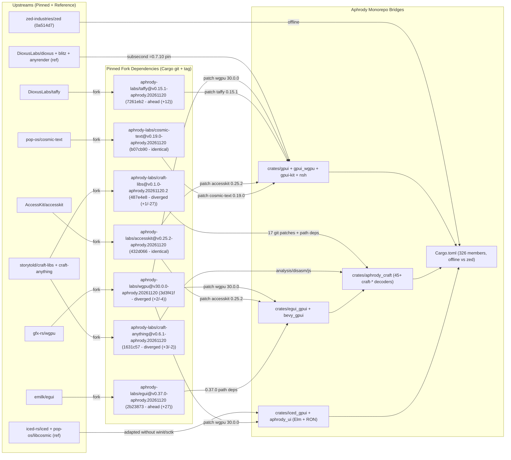

# GPUI vs Dioxus vs egui / craft-libs vs Iced / libcosmic: Audit, Benchmarks, Feature Matrix & Dependency Conflicts

> Code-verified multi-ecosystem audit, real microbenchmarks, Cargo feature matrix, and `Cargo.lock` conflict analysis across [`crates/gpui`](../../../crates/gpui/Cargo.toml), [`crates/egui_gpui`](../../../crates/egui_gpui/Cargo.toml), [`crates/aphrody_craft`](../../../crates/aphrody_craft/Cargo.toml), and [`crates/iced_gpui`](../../../crates/iced_gpui/Cargo.toml).

---

## 1. Automated CLI & Live Telemetry Snapshot

```bash
bun tooling/bun/gpui-vs-dioxus-audit.ts audit   # Pinned forks, crates.io, Cargo.lock conflicts, features
bun tooling/bun/gpui-vs-dioxus-audit.ts bench   # Run measured Rust + Bun parity benchmarks
bun tooling/bun/gpui-vs-dioxus-audit.ts all     # Full audit + benchmark + TOML + markdown refresh
bun test tooling/bun/gpui-vs-dioxus-audit.test.ts
```

<!-- BEGIN GPUI_DIOXUS_METRICS -->
| Audit Dimension | Live Verified Telemetry | Evidence Anchor |
| :--- | :--- | :--- |
| **Aphrody Workspace** | `326` members, `8` pinned fork git dependencies, `35` `[patch.crates-io]` overrides (`offline` vs `zed` 95 419★) | [`Cargo.toml`](../../../Cargo.toml), [`forks-manifest.json`](../../../tooling/bun/forks-manifest.json) |
| **Cargo.lock Graph & Splits** | `2508` packages across `48` git repos; `233` multi-version crates | [`Cargo.lock`](../../../Cargo.lock) |
| **Feature Matrix** | `24` Cargo manifests parsed across 6 ecosystems (`281` Cargo features) | `cargo metadata --no-deps` |
| **Measured Studio Bench** | GPUI tree: `n/a us`, egui 0.37: `n/a us`, Bevy: `n/a us`, craft_sniff x100: `n/a us`, Iced x1000: `n/a us`, RON x100: `n/a us` | [`studio_parity_report.rs`](../../../crates/aphrody_craft/examples/studio_parity_report.rs) |
<!-- END GPUI_DIOXUS_METRICS -->

---

## 2. Live Fork & Workspace Architecture Graph

<!-- BEGIN GPUI_DIOXUS_FORK_GRAPH -->

<!-- END GPUI_DIOXUS_FORK_GRAPH -->

---

## 3. Pinned Fork Dependencies & Reference Ecosystems

<!-- BEGIN GPUI_DIOXUS_FORKS -->
| Pinned Fork / Reference | Pin / Bridge | Upstream Target | Drift / Role |
| :--- | :--- | :--- | :--- |
| `aphrody-labs/wgpu` | `v30.0.0-aphrody.20261120` (`3d3f41fd`, `cargo-pinned`) | `gfx-rs/wgpu@trunk` | `diverged (+2/-4)` — Single-source WGPU v30 + Naga v30 stack shared by gpui_wgpu, egui-wgpu, iced_gpui, bevy_gpui & nsh-engine |
| `aphrody-labs/taffy` | `v0.15.1-aphrody.20261120` (`7261eb2d`, `cargo-pinned`) | `DioxusLabs/taffy@main` | `ahead (+12)` — Patched Flexbox/Grid/Block layout engine shared by gpui, nsh-core & aphrody_session |
| `aphrody-labs/cosmic-text` | `v0.19.0-aphrody.20261120` (`b07cb90a`, `cargo-pinned`) | `pop-os/cosmic-text@main` | `identical` — Patched HarfBuzz/Swash text shaper & font fallback engine shared by gpui_wgpu |
| `aphrody-labs/accesskit` | `v0.25.2-aphrody.20261120` (`432d0665`, `cargo-pinned`) | `AccessKit/accesskit@main` | `identical` — Patched OS UIA/AT-SPI2/AX semantic tree unified across gpui, egui 0.37 & aphrody_pilot |
| `aphrody-labs/egui` | `v0.37.0-aphrody.20261120` (`2b238731`, `cargo-pinned`) | `storytold/egui@main` | `ahead (+27)` — Immediate-mode GUI v0.37 embedded via crates/egui_gpui & crates/bevy_gpui on shared wgpu v30 + accesskit |
| `aphrody-labs/craft-libs` | `v0.1.0-aphrody.20261120.2` (`487e4e88`, `cargo-pinned`) | `storytold/craft-libs@main` | `diverged (+1/-27)` — 45+ pure-Rust format/decoder/sniff crates powering crates/aphrody_craft & crates/bevy_gpui |
| `aphrody-labs/craft-anything` | `v0.6.1-aphrody.20261120` (`1631c57f`, `cargo-pinned`) | `storytold/craft-anything@main` | `diverged (+3/-2)` — Disasm/JS/Evidence/Formats inspector crates embedded into crates/aphrody_craft |
| `aphrody-labs/wry` | `v0.57.3-aphrody.20261120` (`259b0969`, `cargo-pinned`) | `tauri-apps/wry@dev` | `identical` — Native WebView2/WebKit/WebKitGTK host consumed by crates/nsh-platform-gpui |
| *(reference only)* `dioxus` | `crates/gpui/src/hot_reload.rs (subsecond =0.7.10)` | `DioxusLabs/dioxus` (39 862★) | Root pulls subsecond 0.7.10 from crates.io; dioxus 0.8 alpha pulls conflicting anyrender 0.14 / vello 0.11 |
| *(reference only)* `blitz` | `crates/aphrody_ui/src/unified_runtime.rs (FrameworkLayer::Blitz)` | `DioxusLabs/blitz` (4 494★) | HTML5/CSS Stylo reference only; pulls anyrender 0.15 / winit 0.31-beta outside Cargo.lock |
| *(reference only)* `anyrender` | `crates/gpui_wgpu/src/wgpu_context.rs (WgpuContext::shared_handles)` | `DioxusLabs/anyrender` (122★) | Zero-copy shared WGPU handle target; not a workspace Cargo dep |
| *(reference only)* `iced` | `crates/iced_gpui + aphrody_ui::reactive` | `iced-rs/iced` (32 084★) | Upstream iced pulls older wgpu + winit + softbuffer; superseded locally by iced_gpui on wgpu v30 |
| *(reference only)* `libcosmic` | `aphrody_ui::{cosmic_shell,cosmic_theme} + crates/iced_gpui` | `pop-os/libcosmic` (970★) | Pulls iced + sctk versions conflicting with gpui_linux; the pinned cosmic-text keeps text shaping local |
<!-- END GPUI_DIOXUS_FORKS -->

---

## 4. Live `crates.io` Upstream Ecosystem Snapshot

<!-- BEGIN GPUI_DIOXUS_CRATES_IO -->
| Crate | Max Version (`crates.io`) | Max Stable | Total Downloads | Recent 90d |
| :--- | :--- | :--- | ---: | ---: |
| `gpui` | `0.2.2` | `0.2.2` | 530 576 | 307 789 |
| `dioxus` | `0.8.0-alpha.3` | `0.7.10` | 3 847 504 | 1 453 069 |
| `dioxus-cli` | `0.8.0-alpha.3` | `0.7.10` | 394 603 | 67 514 |
| `dioxus-native` | `0.8.0-alpha.3` | `0.7.10` | 49 806 | 21 048 |
| `subsecond` | `0.8.0-alpha.3` | `0.7.10` | 3 219 326 | 1 566 445 |
| `manganis` | `0.8.0-alpha.3` | `0.7.10` | 2 879 993 | 1 224 470 |
| `blitz-dom` | `0.3.0-beta.4` | `0.2.4` | 348 548 | 109 538 |
| `anyrender` | `0.15.0` | `0.15.0` | 318 229 | 216 747 |
| `vello` | `0.12.0` | `0.12.0` | 1 235 765 | 495 023 |
| `egui` | `0.37.0` | `0.37.0` | 32 522 906 | 10 515 475 |
| `eframe` | `0.37.0` | `0.37.0` | 25 746 710 | 8 778 685 |
| `egui-wgpu` | `0.37.0` | `0.37.0` | 18 916 361 | 8 320 361 |
| `epaint` | `0.37.0` | `0.37.0` | 32 493 706 | 10 547 781 |
| `iced` | `0.14.0` | `0.14.0` | 3 433 278 | 861 758 |
| `iced_core` | `0.14.0` | `0.14.0` | 3 547 646 | 874 801 |
| `iced_wgpu` | `0.14.0` | `0.14.0` | 3 359 707 | 825 667 |
| `iced_winit` | `0.14.1` | `0.14.1` | 3 403 390 | 838 053 |
| `smithay-client-toolkit` | `0.21.1` | `0.21.1` | 80 883 003 | 25 258 689 |
| `cosmic-text` | `0.19.0` | `0.19.0` | 12 874 019 | 5 373 060 |
| `softbuffer` | `0.4.8` | `0.4.8` | 35 645 528 | 15 109 025 |
| `wgpu` | `30.0.2` | `30.0.2` | 52 776 051 | 20 597 106 |
| `taffy` | `0.15.1` | `0.15.1` | 21 090 002 | 9 479 020 |
| `accesskit` | `0.25.2` | `0.25.2` | 36 902 340 | 13 116 450 |
| `winit` | `0.31.0-beta.4` | `0.30.13` | 68 043 572 | 17 894 972 |
| `wry` | `0.57.3` | `0.57.3` | 50 115 896 | 20 733 556 |
| `harfrust` | `0.16.1` | `0.16.1` | 21 757 642 | 15 497 599 |
| `skrifa` | `0.50.0` | `0.50.0` | 53 710 672 | 32 318 512 |
| `ropey` | `2.0.0-beta.1` | `1.6.1` | 15 711 264 | 5 083 409 |
<!-- END GPUI_DIOXUS_CRATES_IO -->

---

## 5. Extracted Cargo Feature Matrix (GPUI / NSH / egui / craft-libs / Iced / Foundations)

<!-- BEGIN GPUI_DIOXUS_FEATURES -->
| Manifest Path | Ecosystem | Crate & Version | Features | Default / Sample Flags |
| :--- | :--- | :--- | ---: | :--- |
| `crates/gpui/Cargo.toml` | `aphrody-gpui` | `gpui` `0.2.2` | **18** | `bench, bench-support, default, font-kit, hot-reload, inspector, leak-detection, objc2, +10` |
| `crates/gpui_wgpu/Cargo.toml` | `aphrody-gpui` | `gpui_wgpu` `0.1.0` | **5** | `bench-support, default, font-kit, test-support, webgl-fallback` |
| `crates/gpui_web/Cargo.toml` | `aphrody-gpui` | `gpui_web` `0.1.0` | **3** | `default, multithreaded, webgl-fallback` |
| `crates/gpui_ui/Cargo.toml` | `aphrody-gpui` | `gpui_ui` `0.1.0` | **17** | `default, desktop, hot-reload, inspector, kit, material3, nsh, nsh-dev, +9` |
| `crates/gpui_platform/Cargo.toml` | `aphrody-gpui` | `gpui_platform` `0.1.0` | **12** | `bench-support, default, font-kit, gpui_wgpu, inspector, multithreaded, runtime_shaders, screen-capture, +4` |
| `crates/gpui_windows/Cargo.toml` | `aphrody-gpui` | `gpui_windows` `0.1.0` | **4** | `default, scap, screen-capture, test-support` |
| `crates/gpui_macos/Cargo.toml` | `aphrody-gpui` | `gpui_macos` `0.1.0` | **6** | `bench-support, default, font-kit, runtime_shaders, screen-capture, test-support` |
| `crates/gpui_linux/Cargo.toml` | `aphrody-gpui` | `gpui_linux` `0.1.0` | **21** | `as-raw-xcb-connection, ashpd, calloop-wayland-source, default, filedescriptor, gpui_wgpu, open, scap, +13` |
| `crates/gpui_ios/Cargo.toml` | `aphrody-gpui` | `gpui_ios` `0.1.0` | **1** | `runtime_shaders` |
| `crates/gpui-base/Cargo.toml` | `aphrody-gpui` | `gpui-base` `0.10.0` | **5** | `decimal, default, gpui-fast, inspector, test-support` |
| `crates/gpui-component/Cargo.toml` | `aphrody-gpui` | `gpui-component` `0.10.0` | **45** | `decimal, default, gpui-fast, inspector, speech, syntect, test-support, tree-sitter, +37` |
| `crates/gpui-kit/Cargo.toml` | `aphrody-gpui` | `gpui-kit` `0.10.0` | **48** | `assets, component, decimal, default, gpui-fast, inspector, profiler, speech, +40` |
| `crates/aphrody_ui/Cargo.toml` | `aphrody-gpui` | `aphrody_ui` `0.1.0` | **2** | `default, test-support` |
| `crates/aphrody_desktop/Cargo.toml` | `aphrody-gpui` | `aphrody_desktop` `0.1.0` | **10** | `cli, default, desktop, mobile, shell-module, vpn, web, web-slim, +2` |
| `crates/aphrody_store/Cargo.toml` | `aphrody-gpui` | `aphrody_store` `0.1.0` | **10** | `default, desktop, mobile, nsh-dev, nsh-js, nsh-ui, slim, test-support, +2` |
| `crates/nsh-core/Cargo.toml` | `aphrody-nsh` | `nsh-core` `0.6.0` | **7** | `declarations, glsl, loader, shader, svg, updater, websocket` |
| `crates/nsh-base/Cargo.toml` | `aphrody-nsh` | `nsh-base` `0.6.0` | **8** | `default, editor, emoji-picker, highlight, math, plot, rich-editor, term` |
| `crates/nsh-engine/Cargo.toml` | `aphrody-nsh` | `nsh-engine` `0.6.0` | **10** | `browser, crypto, default, js, js-core, net, shader, updater, +2` |
| `crates/nsh-platform-gpui/Cargo.toml` | `aphrody-nsh` | `nsh-platform-gpui` `0.6.0` | **21** | `crypto, default, dev, editor, emoji-picker, highlight, js, math, +13` |
| `crates/nsh-platform-web/Cargo.toml` | `aphrody-nsh` | `nsh-platform-web` `0.6.0` | **10** | `base-full, browser, browser-core, browser-tests, compiler, default, dev, linkable, +2` |
| `crates/egui_gpui/Cargo.toml` | `egui` | `egui_gpui` `0.37.0` | **2** | `default, wgpu` |
| `crates/bevy_gpui/Cargo.toml` | `egui` | `bevy_gpui` `0.20.0` | **2** | `default, wgpu` |
| `crates/aphrody_craft/Cargo.toml` | `craft-libs` | `aphrody_craft` `0.1.0` | **11** | `codecs, craft-anything, default, figcraft, full, native-inspect, storytold-suite, studio, +3` |
| `crates/iced_gpui/Cargo.toml` | `iced-libcosmic` | `iced_gpui` `0.14.0` | **3** | `cosmic-theme, default, wgpu` |
<!-- END GPUI_DIOXUS_FEATURES -->

---

## 6. Dependency Conflicts & `[patch]` Unification (`Cargo.lock`)

<!-- BEGIN GPUI_DIOXUS_BRIDGES -->
| Crate / Ecosystem | Status | Active Versions | Consumers & Root Cause | Resolution |
| :--- | :--- | :--- | :--- | :--- |
| `wgpu` | `unified-by-patch` | `30.0.0` | 30.0.0 <- aphrody_cli@0.1.0, egui-wgpu@0.37.0, gpui_wgpu@0.1.0, iced_gpui@0.14.0, nsh-engine@0.6.0 — Shared by gpui_wgpu, egui-wgpu, iced_gpui, nsh-engine, aphrody_cli; older upstream iced/eframe pull wgpu 24–28. | UNIFIED: Root Cargo.toml pins aphrody-labs/wgpu (v30.0.0) as a single git tag across all crates; iced & libcosmic are adapted via iced_gpui. |
| `taffy` | `unified-by-patch` | `0.15.1` | 0.15.1 <- aphrody_session@0.1.0, gpui@0.2.2, nsh-core@0.6.0 — Layout engine for gpui, nsh-core, aphrody_session (vs upstream blitz-dom / dioxus). | UNIFIED: Root Cargo.toml pins aphrody-labs/taffy (0.15.1) as a single git tag. |
| `accesskit` | `unified-by-patch` | `0.25.2` | 0.25.2 <- accesskit_atspi_common@0.21.1, accesskit_consumer@0.39.2, accesskit_macos@0.27.2, accesskit_unix@0.24.1, accesskit_windows@0.35.2, aphrody_pilot@0.1.0 (+5) — Accessibility tree across gpui, gpui_{linux,macos,windows}, egui 0.37, aphrody_pilot. | UNIFIED: Root Cargo.toml pins aphrody-labs/accesskit (0.25.2) as a single git tag. |
| `cosmic-text` | `unified-by-patch` | `0.19.0` | 0.19.0 <- gpui_wgpu@0.1.0 — Text shaper across gpui_wgpu vs libcosmic; upstream cosmic-text versions diverge on harfrust/skrifa. | UNIFIED: Root Cargo.toml pins aphrody-labs/cosmic-text (0.19.0) for gpui_wgpu. |
| `ropey` | `lockfile-multi-version` | `1.6.1 | 2.0.0-beta.1` | 1.6.1 <- nsh-base@0.6.0, oxc_data_structures@0.153.0; 2.0.0-beta.1 <- gpui-base@0.10.0, gpui-component@0.10.0 — gpui-base/gpui-component require ropey =2.0.0-beta.1 (`metric_chars`, `metric_utf16`), whereas nsh-base & oxc_data_structures use ropey 1.6.1. | Kept intentionally split via `ropey_kit` workspace alias until nsh-base/oxc upgrade to ropey 2.0 stable. |
| `harfrust` | `lockfile-multi-version` | `0.12.0 | 0.15.0` | 0.12.0 <- cosmic-text@0.19.0; 0.15.0 <- epaint@0.37.0 — epaint 0.37 (aphrody-labs/egui) requires harfrust 0.15.0 + skrifa 0.49, whereas aphrody-labs/cosmic-text 0.19 pins harfrust 0.12.0 + skrifa 0.44. | Tracked across the pinned aphrody-labs/egui vs aphrody-labs/cosmic-text tags; bump cosmic-text upstream or keep egui behind optional feature. |
| `skrifa` | `lockfile-multi-version` | `0.44.0 | 0.49.0` | 0.44.0 <- cosmic-text@0.19.0, swash@0.2.10; 0.49.0 <- epaint@0.37.0, glifo@0.5.0 — Split 0.44.0 (cosmic-text) vs 0.49.0 (epaint/glifo); the craft-libs workspace also references 0.47 (unused). | Aligns automatically when the pinned cosmic-text tag syncs upstream read-fonts 0.46 / skrifa 0.49. |
| `fontdb` | `lockfile-multi-version` | `0.23.0 | 0.24.0` | 0.23.0 <- nsh-platform-gpui@0.6.0, usvg@0.46.0; 0.24.0 <- cosmic-text@0.19.0 — nsh-platform-gpui & usvg 0.46 depend on fontdb 0.23.0 while cosmic-text 0.19 depends on fontdb 0.24.0. | Upstream resvg/usvg 0.47+ or fontique migration required to drop fontdb 0.23.0. |
| `imagesize` | `lockfile-multi-version` | `0.14.0 | 0.15.0` | 0.14.0 <- usvg@0.46.0; 0.15.0 <- nsh-bundler@0.6.0, nsh-core@0.6.0, nsh-macros@0.6.0 — nsh-{core,bundler,macros} use imagesize 0.15.0 while usvg 0.46 pulls imagesize 0.14.0. | Minor pure-Rust header parser split (~15 KB); drops once usvg bumps imagesize 0.15. |
| `lsp-types` | `lockfile-multi-version` | `0.95.1 | 0.97.0` | 0.95.1 <- lsp@0.1.0; 0.97.0 <- gpui-base@0.10.0, gpui-component@0.10.0, gpui-kit@0.10.0 — gpui-base/gpui-component/gpui-kit require crates.io lsp-types 0.97 (`InlineCompletionItem`), whereas Zed crates/lsp uses zed-industries/lsp-types 0.95.1. | Kept isolated via `lsp_types_kit` alias until upstream zed rebases onto lsp-types 0.97+. |
| `notify` | `lockfile-multi-version` | `8.2.2 | 9.0.0-rc.4` | 8.2.2 <- mullvad-daemon@0.0.0; 9.0.0-rc.4 <- fs@0.1.0, gpui-component@0.10.0, nsh-cli@0.6.0 — Zed fs, gpui-component, nsh-cli use zed-industries/notify 9.0.0-rc.4 while the pinned mullvadvpn-app fork uses crates.io notify 8.2.2. | Mullein/Mullvad daemon isolates notify 8.2 behind aphrody_vpn; drops when notify 9.0 stabilizes. |
| `dirs` | `lockfile-multi-version` | `6.0.0 | 7.0.0` | 6.0.0 <- jupyter-zmq-client@3.0.1, shellexpand@3.1.1, zed-font-kit@0.14.1-zed; 7.0.0 <- aphrody_craft@0.1.0, aphrody_session@0.1.0, aphrody_store@0.1.0, aphrody_ui@0.1.0, aphrody_vpn@0.1.0, edit_prediction_cli@0.1.0 (+8) — Workspace updated dirs 6.0 -> 7.0 across Aphrody/Mullvad crates; zed-font-kit/shellexpand still pull dirs 6.0.0; the pinned egui fork references directories 6.0. | Root workspace converged on dirs 7.0; transitive 6.0 drops when zed-font-kit updates. |
| `thiserror` | `lockfile-multi-version` | `1.0.69 | 2.0.21` | 1.0.69 <- cairo-rs@0.18.5, filedescriptor@0.8.3, gio@0.18.4, glib@0.18.5, gotatun@0.10.3, handlebars@4.5.0 (+13); 2.0.21 <- agent@0.1.0, agent_servers@0.1.0, anthropic@0.1.0, aphrody_craft@0.1.0, aphrody_installer@0.1.0, aphrody_session@0.1.0 (+200) — Modern workspace + craft-libs use thiserror 2.0.21; glib 0.18, livekit 0.7, gotatun pull thiserror 1.0.69. | Harmless proc-macro split; shrinks as gtk/livekit migrate to thiserror 2. |
| `windows` | `lockfile-multi-version` | `0.56.0 | 0.57.0 | 0.58.0 | 0.61.3 | 0.62.2` | 0.56.0 <- trash@5.2.5; 0.57.0 <- sysinfo@0.31.4 — 5 major versions in Cargo.lock (0.56..0.62) due to trash (0.56), sysinfo 0.31 (0.57), ipc-channel (0.58), zed-scap/windows-capture (0.61) vs gpui/accesskit (0.62). | Track upstream zed bumps of zed-scap / ipc-channel to converge onto windows 0.62. |
| `craft-* (storytold/craft-libs)` | `unified-by-patch` | `0.1.0 (20 patched git+ overrides)` | crates/aphrody_craft; crates/bevy_gpui — Unpatched storytold/craft-libs git URLs previously triggered duplicate git sources & skrifa 0.47 conflicts. | UNIFIED: All 20 craft-* crates patched via [patch."https://github.com/storytold/craft-libs"] -> 0 git duplicates (pinned at aphrody-labs/craft-libs tags). |
| `iced + libcosmic + dioxus/blitz/anyrender` | `architectural-isolation` | `bridged in-crate (iced_gpui 0.14, aphrody_ui, gpui hot-reload)` | crates/iced_gpui; crates/aphrody_ui — Upstream iced/libcosmic pull incompatible wgpu 24–28 + winit 0.30 + sctk; Dioxus/Blitz split anyrender 0.14 vs 0.15 & vello 0.11 vs 0.12. | ISOLATED: Excluded from root workspace & kept as reference skill only; capabilities live natively in iced_gpui, aphrody_ui, egui_gpui & gpui. |
<!-- END GPUI_DIOXUS_BRIDGES -->

---

## 7. Multi-Framework Comparison Matrix

<!-- BEGIN GPUI_DIOXUS_ECOSYSTEM_MATRIX -->
| Dimension | GPUI / Kit / NSH | Dioxus / Blitz / AnyRender | egui 0.37 / craft-libs | Iced / libcosmic | Unification |
| :--- | :--- | :--- | :--- | :--- | :--- |
| **Reactivity & State** | Entity<T> slotmap + Context<T> (18 features); NSH Solid-style signals (10 features in nsh-engine) | GenerationalBox Signal<T> / RSX VDOM (crates.io reference) | Immediate-mode per-frame closure (2 egui_gpui features) + CraftStudioSession FigCraft history (11 features) | Elm Message/Task batch queue (3 features in iced_gpui) + OsConfigStore | Host long-lived state in GPUI Entity<T>; compose NSH TSX, egui inspectors, and Elm commands inside one window. |
| **Layout & Text Shaping** | Pinned aphrody-labs/taffy 0.15.1 + gpui_wgpu CosmicTextSystem (aphrody-labs/cosmic-text 0.19) | Servo Stylo + stylo_taffy + Parley (reference only) | egui Grid/Strip layout + epaint harfrust 0.15 / skrifa 0.49; craft-fig/usd geometry decoders | Shares GPUI Taffy + M3/COSMIC breakpoints (aphrody_ui) + cosmic-text 0.19 | Single pinned taffy tag across GPUI/NSH; converge cosmic-text up to harfrust 0.15 / skrifa 0.49 to eliminate epaint split. |
| **GPU & AccessKit Wiring** | Metal/D3D11 + gpui_wgpu (wgpu 30.0.0) + AccessKit 0.25.2 | AnyRender + Vello 0.11/0.12 (WgpuContext::shared_handles target) | egui-wgpu 0.37 on the pinned wgpu 30.0.0 + accesskit 0.25.2 tags + Bevy Naga WGSL | iced_gpui runs on GPUI+wgpu 30 (avoids upstream iced wgpu 24–28 & sctk conflicts) | Zero duplicate WGPU/AccessKit crates anywhere in Cargo.lock. |
| **Design Tokens & Contrast** | Compile-time brand::design from google_design_tokens.toml across aphrody_ui, gpui-component, nsh-base | CSS tokens / M3 stylesheet (design-docs-pack) | egui_gpui::theme_bridge maps brand::design directly to egui::Visuals (WCAG AA verified) | cosmic_ron_to_os_theme + OsThemeCatalog (M3 + COSMIC RON palettes) | Zero duplicate hex tables; single compile-time source of truth in crates/brand. |
| **Measured Microbenchmarks** | GPUI tree+TSX build: live bench pending; Lighthouse 100/100 | Hot-reload via subsecond =0.7.10 jump-table (debug devserver) | egui tessellate: live bench pending; craft_sniff: live bench pending; Bevy meshlets: n/a us | Elm dispatch: live bench pending; libcosmic RON parse: live bench pending | Measured live by `studio_parity_report` + `bun tooling/bun/gpui-vs-dioxus-audit.ts bench`. |
| **Dependency Conflict Status** | Lockfile: 2508 pkgs, 233 multi-version (35 patches) | subsecond =0.7.10 pin avoids dioxus 0.8 alpha anyrender/vello split | craft-libs: 20 patches (0 git dups); egui split: harfrust 0.15/skrifa 0.49 | Zero wgpu/winit/sctk conflict (upstream iced/libcosmic replaced by iced_gpui & aphrody_ui) | Next wins: align ropey 2.0 in nsh-base, bump cosmic-text -> harfrust 0.15, converge windows -> 0.62. |
<!-- END GPUI_DIOXUS_ECOSYSTEM_MATRIX -->

---

## 8. Host Tooling & Resolution Plan

<!-- BEGIN GPUI_DIOXUS_UNIFICATION -->
1. **Shared GPU, Layout, Text & A11y Foundations**: `aphrody-labs/wgpu@v30.0.0-aphrody.20261120`, `aphrody-labs/taffy@v0.15.1-aphrody.20261120`, `aphrody-labs/accesskit@v0.25.2-aphrody.20261120`, and `aphrody-labs/cosmic-text@v0.19.0-aphrody.20261120` are single pinned Cargo git dependencies shared across GPUI, NSH, `egui 0.37`, `iced_gpui`, and `bevy_gpui`.
2. **Craft-Libs Zero-Duplicate Patching**: All `20` crates referenced upstream via `https://github.com/storytold/craft-libs` resolve through `[patch."https://github.com/storytold/craft-libs"]` to `aphrody-labs/craft-libs@v0.1.0-aphrody.20261120.2`, leaving `0` duplicate git sources in [`Cargo.lock`](../../../Cargo.lock).
3. **Real Lockfile Splits to Target Next**: Align `nsh-base` onto `ropey 2.0` (when released), bump the pinned `cosmic-text` fork from `harfrust 0.12 / skrifa 0.44` to match `epaint 0.37` (`0.15 / 0.49`), and track Zed upgrades off `lsp-types 0.95.1`, `notify 8.2`, `dirs 6.0`, and legacy `windows 0.56..0.61`.
<!-- END GPUI_DIOXUS_UNIFICATION -->
