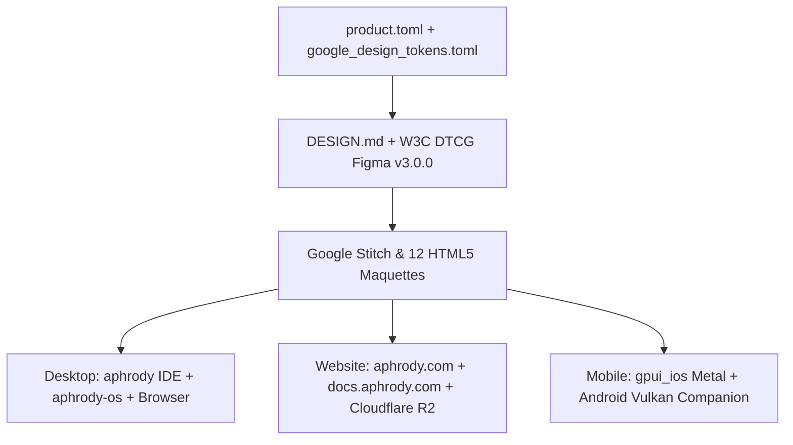

# Aphrody Labs Vision, Multi-Horizon Roadmap & Cross-Platform Design System

> Authoritative architectural specification uniting **Aphrody Labs** (Project Vision & 2026–2027 Roadmap), **Website** (`aphrody.com`, `docs.aphrody.com`, `releases.aphrody.com`), **Desktop** (`aphrody` Studio IDE, `aphrody-os` COSMIC Compositor, Browser + WireGuard VPN), and **Mobile** (`gpui_ios` Metal + `nsh-platform-android` Vulkan) under a single **Material 3 Neural Expressive**, **Figma DTCG v3**, and **Google Stitch** source of truth.

---

## 1. Aphrody Labs Vision & 10-Domain Sovereign Ecosystem

Declared declaratively in [`aphrody_labs_roadmap.toml`](../../assets/os/aphrody_labs_roadmap.toml) alongside [`aphrody-labs-deduplication.md`](./aphrody-labs-deduplication.md) and [`product.toml`](../../product.toml):

- **Core Thesis (*Code Is a Design Material*)**: Live Rust GPUI entities, NSH TSX signals, `egui 0.37` inspectors, Bevy 0.20 / Unreal 5.8 Naga WGSL shaders, and Cloudflare Worker edge HTML share **one strongly-typed design token graph** anchored to `https://design.google/`.
- **Zero-Compromise Stack**: `120 FPS` GPU-native rendering (`gpui` + `vendor/wgpu` v30), **WebAssembly Core 2.0 / WASI Preview 2 AOT**, `vendor/bun` 1.4+ runtime, **$0 Vercel** Cloudflare Workers/R2 + XFS bare-metal fleet (`fr1` / `fr2` / `prd`), and **100% Zed ecosystem compatibility**.

### Sovereign Domain Ownership (`10` Core Pillars)

| Domain | Primary Repository | Target Surfaces | Primary Workspace Paths |
| :--- | :--- | :--- | :--- |
| `aphrody` | `aphrody-dev/aphrody` | Desktop, Web, iOS, Android, MCP | [`crates/aphrody_ui/src/google_design.rs`](../../crates/aphrody_ui/src/google_design.rs) |
| `ai-os` | `aphrody-dev/ai-os` | Desktop, Edge, CLI | [`crates/aphrody_pilot`](../../crates/aphrody_pilot/Cargo.toml) |
| `ay` | `aphrody-dev/ay` | Fleet, SSH, WireGuard | [`tooling/bun/fleet-sync.ts`](../../tooling/bun/fleet-sync.ts) |
| `anu` | `aphrody-dev/anu` | Linux Userspace, WASI | [`crates/aphrody_session`](../../crates/aphrody_session/Cargo.toml) |
| `bun` | `aphrody-labs/bun` | Runtime, Bundler, NSH | [`tooling/bun/design-docs-pack.ts`](../../tooling/bun/design-docs-pack.ts) |
| `browser` | `aphrody-labs/browser` | GPUI Chromium + WebGPU | [`crates/aphrody_browser`](../../crates/aphrody_browser/Cargo.toml) |
| `open` | `aphrody-labs/open` | CDP, TUI, Tunnel | [`crates/aphrody_pilot/src/browser.rs`](../../crates/aphrody_pilot/src/browser.rs) |
| `auto` | `aphrody-labs/auto` | CI/CD & Cloudflare Edge | [`.cloudflare/aphrody-worker/src/index.ts`](../../.cloudflare/aphrody-worker/src/index.ts) |
| `nie` | `aphrody-labs/nie` | Bevy 0.20 + Unreal 5.8 | [`crates/bevy_gpui`](../../crates/bevy_gpui/Cargo.toml) |
| `shenron` | `aphrody-labs/shenron` | Multimodal Voice & AI UI | [`crates/aphrody_ui/src/google_design_components.rs`](../../crates/aphrody_ui/src/google_design_components.rs) |

---

## 2. Multi-Horizon Roadmap (`2026-Q4` &rarr; `2027-Q4`)

| Horizon | Window | Status | Surfaces | Key Milestones & Exit KPIs |
| :--- | :--- | :--- | :--- | :--- |
| **H0** | `2026-Q4` | `completed` | Project, Desktop, Website | Upstream Zed merge (`0` conformity warnings), WGPU v30 + Wasm Core 2.0 AOT, Storytold 82-repo unification, `aphrody_design`, `aphrody_store` (22 targets), Lighthouse 400/400 starter templates. |
| **H1** | `2027-Q1` | `active` | Project, Website, Desktop | 4-mode theme & color architecture, bundled variable monospace + `Google Sans Flex` 6 axes, Figma DTCG v3 + Code Connect, 12-screen Stitch maquette suite, upgraded Cloudflare R2 portal (`dev` + mobile targets). |
| **H2** | `2027-Q2` | `planned` | Mobile, Project, Website | Aphrody Mobile Companion GA on iOS (`gpui_ios` Metal + `NativeShell.xcframework`) and Android (`nsh-platform-android` Vulkan `.aar`), `NshTrust` Ed25519 signed OTA bundles, `>= 44pt` touch targets. |
| **H3** | `2027-Q3..Q4` | `planned` | All 4 Surfaces | Bootable Sovereign AI OS 1.0 ISO (`aphrody_installer` Btrfs/LUKS2), hardware Wayland Smithay compositor, offline NPU/GPU pilotage, collaborative Bevy UE5.8 + FigCraft CRDT canvas. |

---

## 3. 4-Mode Theme & Color System (WCAG 2.2 AA `>= 4.5:1`)

Defined cleanly across [`google_design_tokens.toml`](../../assets/os/google_design_tokens.toml), [`themes.json`](../../assets/os/themes.json), [`aphrody.json`](../../assets/themes/aphrody/aphrody.json), and [`DESIGN.md`](../../DESIGN.md):

| Theme Mode | `surface` | `surface-container-low` | `surface-container-high` | `primary` / `on-primary` | Signature Accent / Aura |
| :--- | :--- | :--- | :--- | :--- | :--- |
| **Neural Obsidian** (`neural`) | `#0B0E14` | `#13161F` | `#1C202B` | `#8FD0FF` / `#003352` (`7.92:1`) | `#111B3A` radial aura &amp; `#FFB300` Bolt Amber |
| **Material Dark** (`dark`) | `#0E141B` | `#161D25` | `#252C36` | `#8FD0FF` / `#003352` (`7.92:1`) | M3 Expressive Slate Blue |
| **Material Light** (`light`) | `#F7F9FF` | `#EEF3FA` | `#E0E7F1` | `#006399` / `#FFFFFF` (`6.47:1`) | Crisp Daylight Blue |
| **OLED Pitch** (`oled`) | `#000000` | `#0A0E14` | `#1B222E` | `#8FD0FF` / `#003352` (`7.92:1`) | True-black zero-bleed mobile &amp; HDR mode |

Release Channel Tint Chips from [`product.toml`](../../product.toml): `lts` (`#BAE6FD`), `stable` (`#ECF4FF`), `preview` (`#E9D5FF`), `canary` (`#FBCFE8`), `nightly` (`#FDE08A`), `dev` (`#99F6E4`).

---

## 4. Typography & Bundled Font Architecture

- **Display & UI Chrome (`Google Sans Flex`)**: Continuous 6-axis tuning via [`GoogleSansFlexAxes`](../../crates/aphrody_ui/src/google_design.rs) (`opsz` 6..144, `wght` 100..1000, `wdth` 25..151, `GRAD` -50..200, `slnt` -10..0, `ROND` 0..100) with named presets (`display_hero`, `section_headline`, `ui_control`, `compact_mobile`, `tabular_label`).
- **Bundled Developer & UI Fonts (`crates/assets`)**:
  - [`GoogleSansCode-Variable.ttf`](../../assets/fonts/google-sans-code/GoogleSansCode-Variable.ttf) (SIL OFL 1.1)
  - [`JetBrainsMono-Regular.ttf`](../../assets/fonts/jetbrains-mono/JetBrainsMono-Regular.ttf) (SIL OFL 1.1)
  - Existing bundled `IBM Plex Sans` and `Lilex` families for offline fallback consistency.

---

## 5. Brand Monogram & Cross-Platform Iconography

- **Brand Master Vector**: [`aphrody_logo.svg`](../../assets/images/aphrody_logo.svg) + curated Neural Expressive vector [`aphrody-monogram-neural.svg`](../design/svg/aphrody-monogram-neural.svg) (`#004B75 -> #135B82` tile + `#FFFFFF` geometric `A` + `#FFB300` Bolt) and mobile adaptive safe-zone foreground [`aphrody-mobile-adaptive-fg.svg`](../design/svg/aphrody-mobile-adaptive-fg.svg).
- **UI Icon Registry ([`crates/icons/src/icons.rs`](../../crates/icons/src/icons.rs))**: Enforces a strict 1:1 SVG bijection test (`test_all_icons_exist` + `test_no_dangling_icons`) including `AiAphrody`, `DesignStitch`, `Figma`, `MobilePhone`, `VpnShield`, and `Webgpu`.

---

## 6. Figma Design System (`v3.0.0`) & Code Connect

Generated deterministically by [`design-docs-pack.ts`](../../tooling/bun/design-docs-pack.ts):

- **Variables Kit ([`figma-design-kit.json`](../design/kits/figma-design-kit.json))**: W3C DTCG 2025.10 schema with **6 variable collections** (`01_Ref/Palette`, `02_Sys/Color` [4 modes], `03_Sys/Typography`, `04_Sys/Layout_Responsive` [Mobile 390 / Tablet 834 / Desktop 1440 / Ultrawide 1920], `05_Sys/Shape_Elevation`, `06_Sys/Motion_Springs`) and **20 Auto-Layout Component Sets**.
- **Code Connect ([`figma-code-connect.json`](../design/kits/figma-code-connect.json))**: Maps all 20 Figma Component Sets across GPUI, NSH TSX, `egui_gpui`, Web CSS, iOS (`gpui_ios` / `NativeShell`), and Android (`nsh-platform-android`).

---

## 7. Google Stitch Kit (`v3.0.0`) & 12 Interactive Maquettes

- **Stitch Kit ([`stitch-design-kit.json`](../design/kits/stitch-design-kit.json)) & Rust Catalog ([`stitch_client.rs`](../../crates/aphrody_design/src/stitch_client.rs))**: Tracks upstream Stitch project references, `data-stitch-id` slot preservation, native [`DesignStitchStudioItem`](../../crates/aphrody_nsh/src/design_stitch_studio.rs) preview panes, and all 12 screens browsable from [`maquettes/index.html`](../design/maquettes/index.html) and implemented cleanly for mobile in [`examples/nsh/mobile-companion/App.tsx`](../../examples/nsh/mobile-companion/App.tsx).
- **Headless CDP Visual Pipeline ([`design-maquettes.ts`](../../tooling/bun/design-maquettes.ts))**: Executes `bun run design:capture` to verify zero broken SVGs, computed CSS primary tokens, and captures crisp Desktop (`1440x900`) &amp; Mobile (`390x844`) PNGs in gitignored `target/design-maquettes/`.
