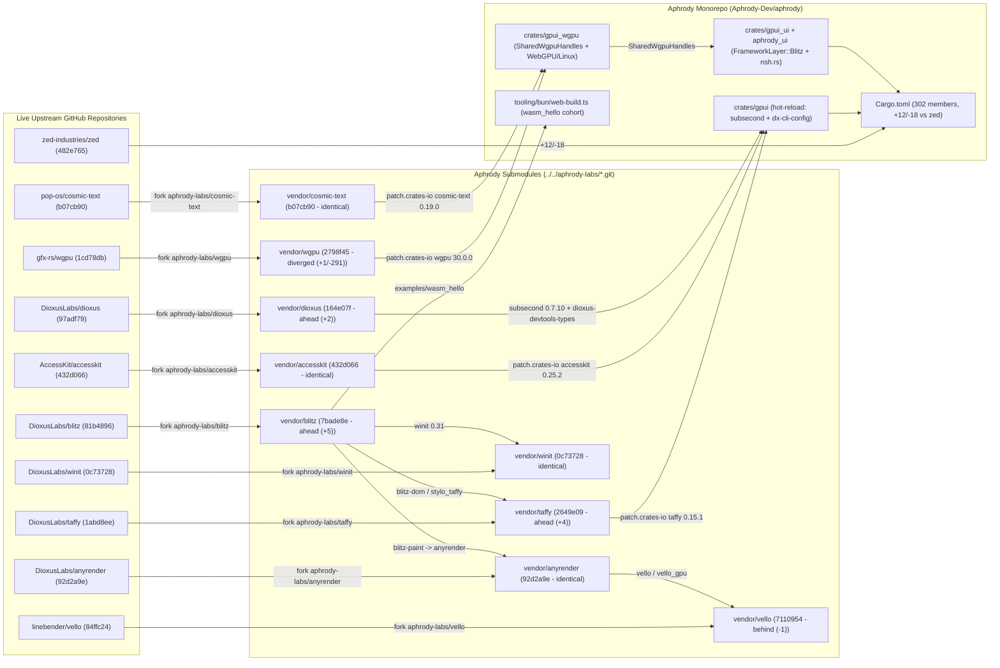

# GPUI vs Dioxus / Blitz / AnyRender Architecture & Fork Audit

> Live code-verified architecture graph, submodule fork telemetry, Cargo feature matrices, `crates.io` snapshots, and integration bridge verification for [`Aphrody-Dev/aphrody`](https://github.com/Aphrody-Dev/aphrody) across [`crates/gpui`](../../crates/gpui/Cargo.toml), [`vendor/dioxus`](../../vendor/dioxus/Cargo.toml), [`vendor/blitz`](../../vendor/blitz/Cargo.toml), and [`vendor/anyrender`](../../vendor/anyrender/Cargo.toml).

---

## 1. Automated Audit & Verification CLI

All telemetry in [`assets/os/gpui_vs_dioxus_matrix.toml`](../../assets/os/gpui_vs_dioxus_matrix.toml), `target/gpui-vs-dioxus/audit.json`, and the generated sections below is computed by [`tooling/bun/gpui-vs-dioxus-audit.ts`](../../tooling/bun/gpui-vs-dioxus-audit.ts) and verified by [`tooling/bun/gpui-vs-dioxus-audit.test.ts`](../../tooling/bun/gpui-vs-dioxus-audit.test.ts):

```bash
bun tooling/bun/gpui-vs-dioxus-audit.ts audit   # Live submodule + fork + cargo metadata + crates.io + bridge scan -> target/gpui-vs-dioxus/audit.json
bun tooling/bun/gpui-vs-dioxus-audit.ts emit    # Regenerate assets/os/gpui_vs_dioxus_matrix.toml and synchronized doc sections
bun tooling/bun/gpui-vs-dioxus-audit.ts all     # Full audit + emit refresh
bun test tooling/bun/gpui-vs-dioxus-audit.test.ts
```

### Live Verified Telemetry Snapshot

<!-- BEGIN GPUI_DIOXUS_METRICS -->
| Audit Dimension | Live Verified Telemetry | Evidence Anchor |
| :--- | :--- | :--- |
| **Aphrody Root Workspace** | `302` members, `20` excluded, `37` submodules, `28` `[patch.crates-io]` overrides (`diverged` vs `zed-industries/zed` 95,163★) | [`Cargo.toml`](../../Cargo.toml), [`.gitmodules`](../../.gitmodules) |
| **GPUI Core & Subsecond Pin** | `gpui 0.2.2` (`18` Cargo features), `hot-reload` pins `subsecond =0.7.10` matching host `dx` (`dioxus 0.7.10 (57d6794)`) | [`crates/gpui/Cargo.toml`](../../crates/gpui/Cargo.toml), [`crates/gpui/src/hot_reload.rs`](../../crates/gpui/src/hot_reload.rs) |
| **Tracked UI/GPU Submodules** | `9` submodules audited (`4` forks ahead of upstream, `4` patched into root `Cargo.toml`) | [`assets/os/gpui_vs_dioxus_matrix.toml`](../../assets/os/gpui_vs_dioxus_matrix.toml) |
| **Cargo Feature Matrices** | `49` Cargo manifests parsed (`444` total declared Cargo features across GPUI, NSH, Dioxus, Blitz, AnyRender, Foundation) | `cargo metadata --no-deps --format-version 1` |
| **Live crates.io Snapshots** | `15/15` crates queried live (`gpui` `0.2.2`, `dioxus` `0.8.0-alpha.3`, `taffy` `0.15.1`, `wgpu` `30.0.2`) | `https://crates.io/api/v1/crates/*` |
| **Code Bridges & Version Splits** | `2` active Rust integration bridges + `1` verified multi-version splits + `6/6` host CLI tools | `target/gpui-vs-dioxus/audit.json` |
<!-- END GPUI_DIOXUS_METRICS -->

---

## 2. Live Fork & Workspace Architecture Graph

<!-- BEGIN GPUI_DIOXUS_FORK_GRAPH -->

<!-- END GPUI_DIOXUS_FORK_GRAPH -->

---

## 3. Submodule & Fork Drift Audit (`.gitmodules` vs `aphrody-labs/*` vs Upstream)

<!-- BEGIN GPUI_DIOXUS_SUBMODULES -->
| Submodule Path | Local Pin | Aphrody Fork Head | Live Upstream Head | Drift (Fork vs Upstream) | Root Cargo Wiring | Latest / Custom Delta |
| :--- | :--- | :--- | :--- | :--- | :--- | :--- |
| `vendor/dioxus` | `164e07f9` (`clean`) | `aphrody-labs/dioxus@main` (`164e07f9`) | `DioxusLabs/dioxus@main` (`97adf791`) | `+2/-0` / `ahead (+2)` | Excluded workspace | `525d4026` rg: upstream sync workflow and optimisation profiles; `164e07f9` rg: retry upstream API calls, skip a PR on a transient error |
| `vendor/blitz` | `7bade8ea` (`clean`) | `aphrody-labs/blitz@main` (`7bade8ea`) | `DioxusLabs/blitz@main` (`81b48968`) | `+5/-0` / `ahead (+5)` | Excluded workspace | `a84a3c51` rg: upstream sync workflow and optimisation profiles; `e4121d1a` Merge upstream DioxusLabs/blitz main (1311a45e) |
| `vendor/anyrender` | `92d2a9ea` (`clean`) | `aphrody-labs/anyrender@main` (`92d2a9ea`) | `DioxusLabs/anyrender@main` (`92d2a9ea`) | `+0/-0` / `identical` | Excluded workspace | anyrender_serialize: upgrade sha2 to 0.11 |
| `vendor/taffy` | `2649e09d` (`clean`) | `aphrody-labs/taffy@main` (`2649e09d`) | `DioxusLabs/taffy@main` (`1abd8eea`) | `+4/-0` / `ahead (+4)` | Yes (`[patch.crates-io]`) | `7d6a644e` version 0.15.1: patch outranks the registry release so the workspace resolves this checkout; `49124638` rg: upstream sync workflow and optimisation profiles |
| `vendor/wgpu` | `2798f45c` (`clean`) | `aphrody-labs/wgpu@main` (`2798f45c`) | `gfx-rs/wgpu@trunk` (`1cd78db6`) | `+1/-291` / `diverged (+1/-291)` | Yes (`[patch.crates-io]`) | `2798f45c` wgpu-hal/metal: probe accepted_msl_version (#742) |
| `vendor/vello` | `71109540` (`clean`) | `aphrody-labs/vello@main` (`71109540`) | `linebender/vello@main` (`84ffc24a`) | `+0/-1` / `behind (-1)` | Excluded workspace | vello_tests: Bump three GPU tolerances for an RTX 3090 Ti on Windows (#2089) |
| `vendor/cosmic-text` | `b07cb90a` (`clean`) | `aphrody-labs/cosmic-text@main` (`b07cb90a`) | `pop-os/cosmic-text@main` (`b07cb90a`) | `+0/-0` / `identical` | Yes (`[patch.crates-io]`) | Add ascender and descender sizes in pixels to LayoutGlyph |
| `vendor/accesskit` | `432d0665` (`clean`) | `aphrody-labs/accesskit@main` (`432d0665`) | `AccessKit/accesskit@main` (`432d0665`) | `+0/-0` / `identical` | Yes (`[patch.crates-io]`) | fix: Only hit-test iOS accessibility elements (#862) |
| `vendor/winit` | `0c737280` (`clean`) | `aphrody-labs/winit@main` (`0c737280`) | `DioxusLabs/winit@master` (`0c737280`) (root `rust-windowing/winit` `f0abec9`) | `+0/-0` / `identical` | Excluded workspace | X11: fix 32 bit build (no AtomicI64 on ppc) |
<!-- END GPUI_DIOXUS_SUBMODULES -->

---

## 4. Live `crates.io` Upstream Ecosystem Snapshot

<!-- BEGIN GPUI_DIOXUS_CRATES_IO -->
| Crate | Max Version (`crates.io`) | Max Stable | Total Downloads | Recent 90d | Updated |
| :--- | :--- | :--- | ---: | ---: | :--- |
| `dioxus` | `0.8.0-alpha.3` | `0.7.10` | 3,759,386 | 1,406,941 | `2026-10-16` |
| `dioxus-cli` | `0.8.0-alpha.3` | `0.7.10` | 390,746 | 66,093 | `2026-10-16` |
| `dioxus-native` | `0.8.0-alpha.3` | `0.7.10` | 49,301 | 21,306 | `2026-10-16` |
| `subsecond` | `0.8.0-alpha.3` | `0.7.10` | 3,112,855 | 1,500,326 | `2026-10-16` |
| `manganis` | `0.8.0-alpha.3` | `0.7.10` | 2,804,553 | 1,184,337 | `2026-10-16` |
| `blitz-dom` | `0.3.0-beta.4` | `0.2.4` | 339,608 | 102,621 | `2026-10-16` |
| `blitz-html` | `0.3.0-beta.4` | `0.2.0` | 309,035 | 114,058 | `2026-10-16` |
| `anyrender` | `0.15.0` | `0.15.0` | 296,760 | 199,164 | `2026-11-16` |
| `gpui` | `0.2.2` | `0.2.2` | 507,335 | 294,325 | `2026-10-30` |
| `wgpu` | `30.0.2` | `30.0.2` | 51,202,100 | 19,497,928 | `2026-11-12` |
| `taffy` | `0.15.1` | `0.15.1` | 20,412,286 | 9,069,429 | `2026-10-25` |
| `vello` | `0.12.0` | `0.12.0` | 1,206,162 | 487,353 | `2026-11-11` |
| `cosmic-text` | `0.19.0` | `0.19.0` | 12,533,508 | 5,179,684 | `2026-04-22` |
| `accesskit` | `0.25.2` | `0.25.2` | 35,810,519 | 12,310,643 | `2026-10-25` |
| `winit` | `0.31.0-beta.4` | `0.30.13` | 66,776,249 | 17,104,005 | `2026-10-24` |
<!-- END GPUI_DIOXUS_CRATES_IO -->

---

## 5. Exact Extracted Cargo Feature Matrices

Extracted directly from root `cargo metadata --no-deps --format-version 1` and live `Cargo.toml` manifests ([`crates/gpui/Cargo.toml`](../../crates/gpui/Cargo.toml), [`crates/gpui_wgpu/Cargo.toml`](../../crates/gpui_wgpu/Cargo.toml), [`crates/gpui_web/Cargo.toml`](../../crates/gpui_web/Cargo.toml), [`crates/gpui_ui/Cargo.toml`](../../crates/gpui_ui/Cargo.toml), [`vendor/dioxus/Cargo.toml`](../../vendor/dioxus/Cargo.toml), [`vendor/dioxus/packages/dioxus/Cargo.toml`](../../vendor/dioxus/packages/dioxus/Cargo.toml), [`vendor/blitz/Cargo.toml`](../../vendor/blitz/Cargo.toml), and companions):

<!-- BEGIN GPUI_DIOXUS_FEATURES -->
| Manifest Path | Ecosystem | Crate & Version | Feature Count | Extracted `[features]` |
| :--- | :--- | :--- | ---: | :--- |
| `crates/gpui/Cargo.toml` | `aphrody-gpui` | `gpui` `0.2.2` | **18** | `bench, bench-support, default, font-kit, hot-reload, inspector, leak-detection, objc2, objc2-metal, profiler, +8 more` |
| `crates/gpui_wgpu/Cargo.toml` | `aphrody-gpui` | `gpui_wgpu` `0.1.0` | **4** | `bench-support, default, font-kit, test-support` |
| `crates/gpui_web/Cargo.toml` | `aphrody-gpui` | `gpui_web` `0.1.0` | **2** | `default, multithreaded` |
| `crates/gpui_ui/Cargo.toml` | `aphrody-gpui` | `gpui_ui` `0.1.0` | **13** | `default, desktop, hot-reload, inspector, nsh, nsh-dev, nsh-full, nsh-js, nsh-math, nsh-shader, +3 more` |
| `crates/gpui_platform/Cargo.toml` | `aphrody-gpui` | `gpui_platform` `0.1.0` | **11** | `bench-support, default, font-kit, gpui_wgpu, inspector, multithreaded, runtime_shaders, screen-capture, test-support, wayland, +1 more` |
| `crates/gpui_windows/Cargo.toml` | `aphrody-gpui` | `gpui_windows` `0.1.0` | **4** | `default, scap, screen-capture, test-support` |
| `crates/gpui_macos/Cargo.toml` | `aphrody-gpui` | `gpui_macos` `0.1.0` | **6** | `bench-support, default, font-kit, runtime_shaders, screen-capture, test-support` |
| `crates/gpui_linux/Cargo.toml` | `aphrody-gpui` | `gpui_linux` `0.1.0` | **21** | `as-raw-xcb-connection, ashpd, calloop-wayland-source, default, filedescriptor, gpui_wgpu, open, scap, screen-capture, test-support, +11 more` |
| `crates/gpui_ios/Cargo.toml` | `aphrody-gpui` | `gpui_ios` `0.1.0` | **1** | `runtime_shaders` |
| `crates/aphrody_store/Cargo.toml` | `aphrody-gpui` | `aphrody_store` `0.1.0` | **8** | `default, desktop, mobile, nsh-dev, nsh-js, nsh-ui, test-support, web` |
| `crates/gpui_app_shell/Cargo.toml` | `aphrody-gpui` | `gpui_app_shell` `0.1.0` | **5** | `default, nsh, nsh-webview, panels, test-support` |
| `crates/aphrody_ui/Cargo.toml` | `aphrody-gpui` | `aphrody_ui` `0.1.0` | **2** | `default, test-support` |
| `crates/aphrody_desktop/Cargo.toml` | `aphrody-gpui` | `aphrody_desktop` `0.1.0` | **6** | `cli, default, desktop, mobile, shell-module, web` |
| `crates/nsh-core/Cargo.toml` | `aphrody-nsh` | `nsh-core` `0.5.0` | **7** | `declarations, glsl, loader, shader, svg, updater, websocket` |
| `crates/nsh-platform-gpui/Cargo.toml` | `aphrody-nsh` | `nsh-platform-gpui` `0.5.0` | **21** | `crypto, default, dev, editor, emoji-picker, highlight, js, math, net, plot, +11 more` |
| `crates/nsh-platform-web/Cargo.toml` | `aphrody-nsh` | `nsh-platform-web` `0.5.0` | **10** | `base-full, browser, browser-core, browser-tests, compiler, default, dev, linkable, std-crypto, std-zlib` |
| `vendor/dioxus/Cargo.toml` | `dioxus` | `dioxus-examples` `0.7.5` | **8** | `default, desktop, gpu, liveview, mobile, native, server, web` |
| `vendor/dioxus/packages/dioxus/Cargo.toml` | `dioxus` | `dioxus` `0.8.0-alpha.3` | **26** | `asset, cli-config, default, desktop, devtools, document, fullstack, hooks, html, launch, +16 more` |
| `vendor/dioxus/packages/core/Cargo.toml` | `dioxus` | `dioxus-core` `0.8.0-alpha.3` | **10** | `default, document, hooks, html, macro, manganis_08, signals, ssr, stores, wasm-split` |
| `vendor/dioxus/packages/native/Cargo.toml` | `dioxus` | `dioxus-native` `0.8.0-alpha.3` | **34** | `accessibility, apple-font-embolden, autofocus, clipboard, complex-scripts, data-uri, default, file-dialog, floats, font-embolden, +24 more` |
| `vendor/dioxus/packages/dx/Cargo.toml` | `dioxus` | `dioxus-cli` `0.8.0-alpha.3` | **4** | `default, disable-telemetry, no-downloads, tokio-console` |
| `vendor/dioxus/packages/web/Cargo.toml` | `dioxus` | `dioxus-web` `0.8.0-alpha.3` | **5** | `default, devtools, document, hydrate, mounted` |
| `vendor/dioxus/packages/desktop/Cargo.toml` | `dioxus` | `dioxus-desktop` `0.8.0-alpha.3` | **6** | `default, devtools, fullscreen, gnu, tokio_runtime, transparent` |
| `vendor/dioxus/packages/fullstack/Cargo.toml` | `dioxus` | `dioxus-fullstack` `0.8.0-alpha.3` | **7** | `default, msgpack, native, postcard, server, web, ws` |
| `vendor/dioxus/packages/liveview/Cargo.toml` | `dioxus` | `dioxus-liveview` `0.8.0-alpha.3` | **4** | `axum, default, devtools, multi-thread` |
| `vendor/dioxus/packages/subsecond/subsecond/Cargo.toml` | `dioxus` | `subsecond` `0.8.0-alpha.3` | **0** | `(none)` |
| `vendor/dioxus/packages/manganis/manganis/Cargo.toml` | `dioxus` | `manganis` `0.8.0-alpha.3` | **1** | `default` |
| `vendor/blitz/Cargo.toml` | `blitz-anyrender` | `blitz-examples` `0.0.1` | **3** | `log-frame-times, log-phase-times, log-times` |
| `vendor/blitz/packages/blitz/Cargo.toml` | `blitz-anyrender` | `blitz` `0.3.0-beta.4` | **7** | `accessibility, default, net, scrollbars, text-transform-icu, tracing, writing-mode` |
| `vendor/blitz/packages/blitz-dom/Cargo.toml` | `blitz-anyrender` | `blitz-dom` `0.3.0-beta.4` | **17** | `accessibility, autofocus, complex-scripts, custom-widget, default, devtools, file-input, floats, log-phase-times, parallel-construct, +7 more` |
| `vendor/blitz/packages/blitz-html/Cargo.toml` | `blitz-anyrender` | `blitz-html` `0.3.0-beta.4` | **2** | `accessibility, tracing` |
| `vendor/blitz/packages/blitz-paint/Cargo.toml` | `blitz-anyrender` | `blitz-paint` `0.3.0-beta.4` | **7** | `apple-font-embolden, custom-widget, default, font-embolden, scrollbars, svg, tracing` |
| `vendor/blitz/packages/blitz-shell/Cargo.toml` | `blitz-anyrender` | `blitz-shell` `0.3.0-beta.4` | **8** | `accessibility, custom-widget, data-uri, default, devtools, embedded-devtools-frontend, file-dialog, tracing` |
| `vendor/blitz/packages/stylo_taffy/Cargo.toml` | `blitz-anyrender` | `stylo_taffy` `0.3.0-beta.4` | **7** | `block, default, flexbox, floats, grid, std, writing-mode` |
| `vendor/blitz/packages/dioxus-native/Cargo.toml` | `blitz-anyrender` | `dioxus-native` `0.7.0` | **35** | `accessibility, apple-font-embolden, autofocus, complex-scripts, data-uri, default, devtools, embedded-devtools-frontend, file-dialog, floats, +25 more` |
| `vendor/blitz/examples/wasm_hello/Cargo.toml` | `blitz-anyrender` | `wasm_hello` `0.0.0` | **0** | `(none)` |
| `vendor/anyrender/crates/anyrender/Cargo.toml` | `blitz-anyrender` | `anyrender` `0.15.0` | **2** | `default, serde` |
| `vendor/anyrender/crates/anyrender_vello/Cargo.toml` | `blitz-anyrender` | `anyrender_vello` `0.16.0` | **1** | `log_frame_times` |
| `vendor/anyrender/crates/anyrender_vello_gpu/Cargo.toml` | `blitz-anyrender` | `anyrender_vello_gpu` `0.12.0` | **2** | `log_frame_times, webgl` |
| `vendor/anyrender/crates/anyrender_vello_cpu/Cargo.toml` | `blitz-anyrender` | `anyrender_vello_cpu` `0.19.0` | **5** | `filters, log_frame_times, multithreading, pixels_window_renderer, softbuffer_window_renderer` |
| `vendor/anyrender/crates/anyrender_skia/Cargo.toml` | `blitz-anyrender` | `anyrender_skia` `0.13.0` | **4** | `log_frame_times, pixels_window_renderer, softbuffer_window_renderer, vulkan` |
| `vendor/taffy/Cargo.toml` | `shared-foundation` | `taffy` `0.15.1` | **18** | `alloc, block_layout, calc, content_size, debug, default, detailed_layout_info, flexbox, flexbox_balance, float_layout, +8 more` |
| `vendor/wgpu/wgpu/Cargo.toml` | `shared-foundation` | `wgpu` `30.0.0` | **25** | `angle, counters, custom, default, drm, dx12, exhaust, fragile-send-sync-non-atomic-wasm, gles, glsl, +15 more` |
| `vendor/vello/research/vello_research/Cargo.toml` | `shared-foundation` | `vello` `0.12.0` | **7** | `bump_estimate, debug_layers, default, hot_reload, wgpu, wgpu-profiler, wgpu_default` |
| `vendor/vello/vello_gpu/Cargo.toml` | `shared-foundation` | `vello_gpu` `0.4.0` | **13** | `all_shader_features, blurred_rounded_rect, default, full_image_support, gradient_sweep, libm, probe, std, text, webgl, +3 more` |
| `vendor/vello/vello_cpu/Cargo.toml` | `shared-foundation` | `vello_cpu` `0.4.0` | **8** | `default, f32_pipeline, libm, multithreading, png, std, text, u8_pipeline` |
| `vendor/cosmic-text/Cargo.toml` | `shared-foundation` | `cosmic-text` `0.19.0` | **10** | `default, fontconfig, monospace_fallback, no_std, peniko, shape-run-cache, std, vi, warn_on_missing_glyphs, wasm-web` |
| `vendor/accesskit/accesskit/Cargo.toml` | `shared-foundation` | `accesskit` `0.25.2` | **4** | `enumn, pyo3, schemars, serde` |
| `vendor/winit/winit/Cargo.toml` | `shared-foundation` | `winit` `0.31.0-beta.4` | **15** | `android-game-activity, android-native-activity, default, mint, private-apple-apis, serde, wayland, wayland-csd-adwaita, wayland-csd-adwaita-cosmic-text, wayland-csd-adwaita-crossfont, +5 more` |
<!-- END GPUI_DIOXUS_FEATURES -->

---

## 6. Code-Verified Integration Bridges & Manifest Version Splits

Verified by scanning `crates/` plus [`tooling/bun/web-build.ts`](../../tooling/bun/web-build.ts), [`crates/gpui/src/hot_reload.rs`](../../crates/gpui/src/hot_reload.rs), [`crates/gpui/src/view.rs`](../../crates/gpui/src/view.rs), [`crates/gpui/build.rs`](../../crates/gpui/build.rs), [`crates/gpui_wgpu/src/wgpu_context.rs`](../../crates/gpui_wgpu/src/wgpu_context.rs), [`crates/aphrody_ui/src/unified_runtime.rs`](../../crates/aphrody_ui/src/unified_runtime.rs), and [`crates/aphrody_desktop/tests/visual_smoke.rs`](../../crates/aphrody_desktop/tests/visual_smoke.rs):

<!-- BEGIN GPUI_DIOXUS_BRIDGES -->
| Bridge / Drift ID | Kind | Verified Files | Verified Symbols / Pins | Code-Verified Findings |
| :--- | :--- | :--- | :--- | :--- |
| `gpui-subsecond-hot-reload` | `active-code-bridge` | `crates/gpui/Cargo.toml`, `crates/gpui/build.rs`, `crates/gpui/src/gpui.rs`, `crates/gpui/src/hot_reload.rs`, `crates/gpui/src/view.rs` | `gpui::hot_reload`, `subsecond::HotFn::current`, `subsecond::apply_patch`, `subsecond::aslr_reference`, `dioxus_cli_config::devserver_raw_addr`, `dioxus_devtools_types::DevserverMsg` | crates/gpui implements native hot-reload behind `feature = "hot-reload"` (enabled in debug assertions on macOS/Linux/Windows/iOS via crates/gpui/build.rs `gpui_hot_reload`), connecting directly to `dx serve --hot-patch` over WebSocket and detouring View/AnyView renders via `subsecond::HotFn::current`. |
| `gpui-wgpu-shared-handles` | `active-code-bridge` | `crates/gpui_wgpu/src/wgpu_context.rs`, `crates/gpui_wgpu/Cargo.toml`, `Cargo.toml` | `SharedWgpuHandles`, `WgpuContext::shared_handles`, `wgpu v30.0.0` | gpui_wgpu::WgpuContext::shared_handles exports cloned WGPU v30 Instance/Adapter/Device/Queue handles explicitly documented to share one GPU device with `aphrody_ui`, `egui-wgpu`, `iced_wgpu`, `anyrender`, and `cef` OSR. |
| `os-ui-framework-layer-blitz` | `runtime-enum` | `crates/aphrody_ui/src/unified_runtime.rs`, `crates/aphrody_desktop/tests/visual_smoke.rs` | `FrameworkLayer::Blitz`, `FrameworkLayer::Taffy`, `FrameworkLayer::Wgpu`, `UnifiedPlatformProfile` | aphrody_ui::unified_runtime::FrameworkLayer models 12 unified UI/render layers including Gpui, Nsh, GpuiKit, Craft, Cosmic, Iced, Egui, Wgpu, Taffy, Blitz, Winit, and TauriBun. |
| `web-build-blitz-cohort` | `tooling-cohort` | `tooling/bun/web-build.ts`, `vendor/blitz/examples/wasm_hello/Cargo.toml` | `FRAMEWORK_SPECS[id=blitz]`, `wasm_hello`, `anyrender_vello` | tooling/bun/web-build.ts registers `vendor/blitz/examples/wasm_hello` (`wasm_hello`) alongside `aphrody_desktop`, `aphrody_store`, `gpui_web`, `nsh`, `craft`, `egui`, `iced`, and `wgpu` for unified Wasm/WebGPU cohort audits. |
| `cargo-patch-shared-foundation` | `cargo-patch-unification` | `Cargo.toml`, `.gitmodules` | `[patch.crates-io].taffy`, `[patch.crates-io].cosmic-text`, `[patch.crates-io].wgpu`, `[patch.crates-io].naga`, `[patch.crates-io].accesskit` | Root Cargo.toml [patch.crates-io] unifies taffy, cosmic-text, wgpu, naga, accesskit directly onto local vendor/* submodule checkouts, while vendor/{dioxus,blitz,anyrender,vello,winit} remain in [workspace.exclude] to prevent multi-workspace Cargo resolver conflicts. |
| `verified-version-splits` | `version-split` | `crates/gpui/Cargo.toml`, `vendor/dioxus/Cargo.toml`, `vendor/blitz/Cargo.toml`, `vendor/anyrender/Cargo.toml`, `vendor/taffy/Cargo.toml` | `gpui->subsecond(=0.7.10)`, `vendor/dioxus(0.8.0-alpha.3)`, `dioxus->anyrender(0.14.0)`, `blitz->anyrender(0.15.0)`, `taffy(0.15.1)` | Live manifest inspection reveals 3 concrete version splits: (1) crates/gpui hot-reload pins subsecond/dioxus-cli-config/dioxus-devtools-types at '=0.7.10' (matching host dx CLI) while vendor/dioxus is already '0.8.0-alpha.3'; (2) vendor/dioxus pins anyrender '0.14.0' + anyrender_vello_hybrid + winit 0.31.0-beta.3 while vendor/blitz + vendor/anyrender already migrated to anyrender '0.15.0' + anyrender_vello_gpu + vello 0.12 + winit 0.31.0-beta.4; (3) vendor/taffy carries fork bump '0.15.1' so [patch.crates-io] outranks crates.io. |
<!-- END GPUI_DIOXUS_BRIDGES -->

---

## 7. 8-Dimension Architecture & Tooling Comparison

<!-- BEGIN GPUI_DIOXUS_ECOSYSTEM_MATRIX -->
| Dimension | GPUI / Aphrody | Dioxus / Blitz / AnyRender | NSH Bridge (`crates/nsh-*`) | Aphrody Unification Path |
| :--- | :--- | :--- | :--- | :--- |
| **Reactivity & State Model** | Entity<T> slotmap arena + Context<T> observers + retained views + immediate Element trees (18 features in crates/gpui). Zero virtual DOM diffing. | GenerationalBox Signal<T> / Memo / Store<T> + VirtualDom + rsx! template macro (26 features in dioxus). Fine-grained signal subscriptions re-render components into template mutations. | crates/nsh-core provides SolidJS-style reactive signals/computed/effects with slab shadow tree bridged into gpui_ui::nsh::AppView. | Keep GPUI Entity<T> as native OS/IDE host state; embed NSH TSX/reactive panels via gpui_ui::nsh and inspect Dioxus Signal patterns for fine-grained invalidation. |
| **Layout & Styling Engine** | Direct taffy::TaffyTree in crates/gpui/src/taffy.rs with Tailwind-like fluent Styled builder (currently clears TaffyTree per frame; merge candidate longbridge/gpui-fast adds dirty tracking). | Full HTML5/CSS cascade via Servo stylo -> stylo_taffy -> taffy + Parley inline text layout inside blitz-dom (17 features) or browser CSS in dioxus-web/desktop. | nsh-core translates Tailwind/CSS utility classes directly to shared vendor/taffy without Servo Stylo overhead. | Both GPUI, Blitz, and NSH converge on single patched vendor/taffy (0.15.1); use direct Taffy for 120 FPS OS chrome and Blitz DOM only when full HTML/CSS rendering is needed. |
| **GPU & Rendering Pipeline** | Hybrid native + WGPU: Metal/CAMetalDisplayLink (macOS/iOS), D3D11/DirectComposition (Windows), gpui_wgpu on wgpu 30.0.0 (Linux Wayland/X11 + WebGPU/WebGL2). Zero Blade remaining. | AnyRender 2D scene abstraction over vello compute, vello_gpu hybrid, vello_cpu sparse strips, or Skia (34 features in dioxus-native), plus Wry WebView in dioxus-desktop. | gpui_wgpu::WgpuContext::shared_handles() explicitly exports WGPU Instance/Adapter/Device/Queue for secondary renderers including anyrender. | Zero-copy compose AnyRender/Vello scenes inside GPUI surfaces using WgpuContext::shared_handles() on unified vendor/wgpu (30.0.0). |
| **Hot-Reload & Dev Server** | crates/gpui/src/hot_reload.rs + view.rs wire Dioxus subsecond jump-table patching (gpui->subsecond(=0.7.10)) + dioxus-cli-config + dioxus-devtools-types over `dx serve --hot-patch` WebSocket. | dx serve provides dual RSX literal/template hot-reload (dioxus-rsx-hotreload) + Subsecond Rust function jump-table patching + ThinLinking (0.8.0-alpha.3). | nsh-dev + nsh-bundler provide Oxc/Rolldown TSX HMR for embedded NSH panels. | Align gpui->subsecond(=0.7.10) pin with vendor/dioxus (0.8.0-alpha.3) once dx 0.8.0 stabilizes so both Rust GPUI and NSH TSX hot-patch from one workflow. |
| **Asset Bundling & Resolution** | Compile-time rust-embed 8.11 (crates/assets) implementing gpui::AssetSource plus brand/theme TOML catalogs (include_str!). | manganis::asset!() macro embeds link-section asset metadata consumed by dx CLI (lightningcss, grass, mozjpeg, imagequant, brotli) + dioxus-asset-resolver. | nsh-core asset loader + aphrody_store embedded TOML catalog. | Keep rust-embed/include_str! for zero-external-CLI Cargo builds of Aphrody OS; use Manganis only inside Dioxus/dx-managed sub-apps. |
| **Multi-Platform & Windowing** | gpui_platform selects custom per-OS native crates (gpui_macos, gpui_windows, gpui_linux, gpui_ios, gpui_web) without Winit overhead. | Unified dioxus crate feature-gates web, desktop (Wry/Tao), mobile, native (Blitz + Winit 0.31), liveview (Axum WS), ssr, and fullstack. | nsh spans GPUI, Web DOM, TUI (Ratatui), Android, iOS, macOS, Linux, and Windows; aphrody_ui tracks all 12 layers. | Use GPUI native platforms for OS/IDE windows (avoiding Winit beta drift) and optionally mount Blitz/Dioxus Native documents as embedded HTML/CSS panes. |
| **Bundle Size & Cross-Compile Tooling** | tooling/bun/web-build.ts builds 3 Wasm cohorts (baseline, simd128, --coi) with [profile.web] + wasm-opt -Oz; tooling/bun/cross-build.ts drives cargo-xwin/cargo-zigbuild. | dx bundle + wasm-split-cli + [profile.wasm-split-release] / [profile.rg-wasm] (opt-level=z, fat LTO, strip) across Web, Desktop, Android, and iOS. | nsh-platform-web linkable Wasm + tooling/bun/web-build.ts tracks blitz wasm_hello alongside aphrody_desktop and gpui_web. | Port Blitz/Taffy [profile.rg-wasm] insights into Aphrody WebGPU CI budgets and reuse wasm-split patterns in tooling/bun/web-build.ts. |
| **Aphrody Fork & Workspace Unification** | Aphrody-Dev/aphrody (diverged vs zed-industries/zed) centralizes 302 workspace crates and patches taffy, cosmic-text, wgpu, accesskit via [patch.crates-io]. | Fork status: vendor/dioxus (ahead (+2)), vendor/blitz (ahead (+5)), vendor/taffy (ahead (+4)), vendor/anyrender (identical), vendor/wgpu (diverged (+1/-291)). | All .gitmodules use relative ../../aphrody-labs/*.git URLs with single checkouts in vendor/*. | Reconcile vendor/dioxus anyrender 0.14/vello 0.11 vs vendor/blitz anyrender 0.15/vello 0.12 and track vendor/wgpu main vs trunk before promoting Blitz into root workspace. |
<!-- END GPUI_DIOXUS_ECOSYSTEM_MATRIX -->

---

## 8. Host Tooling & Unification Action Plan

Host tools probed: `dx` (`dioxus 0.7.10 (57d6794)`), `cargo` (`cargo 1.98.1 (797e8a9bc 2026-08-05)`), `rustc` (`rustc 1.98.1 (48a229cea 2026-09-01)`), `wasm-bindgen` (`wasm-bindgen 0.2.129`), `wasm-opt` (`wasm-opt version 133 (version_133)`), `bun` (`1.4.5`). Installed `rustup` targets: `aarch64-linux-android`, `wasm32-unknown-unknown`, `wasm32-wasip2`, `x86_64-pc-windows-msvc`, `x86_64-unknown-linux-gnu`, `x86_64-unknown-linux-musl`. Unified Wasm cohort specs in [`tooling/bun/web-build.ts`](../../tooling/bun/web-build.ts): `aphrody_desktop(aphrody_desktop)`, `aphrody_store(aphrody_store)`, `gpui_web(gpui_web)`, `nsh(nsh-platform-web)`, `craft(craft-anything-web)`, `egui(egui_demo_app)`, `iced(iced_winit)`, `blitz(wasm_hello)`, `wgpu(wgpu-examples)`.

<!-- BEGIN GPUI_DIOXUS_UNIFICATION -->
1. **Subsecond Version Pin Alignment**: [`crates/gpui/Cargo.toml`](../../crates/gpui/Cargo.toml) pins `subsecond`, `dioxus-cli-config`, and `dioxus-devtools-types` (`gpui->subsecond(=0.7.10)`, matching installed host CLI `dioxus 0.7.10 (57d6794)`), whereas [`vendor/dioxus/Cargo.toml`](../../vendor/dioxus/Cargo.toml) tracks `vendor/dioxus(0.8.0-alpha.3)`. Keep the `=0.7.10` pin while host `dx` is `0.7.10`, and bump in lockstep when `0.8.0` ships.
2. **Blitz / AnyRender / Dioxus Convergence**: [`vendor/dioxus/Cargo.toml`](../../vendor/dioxus/Cargo.toml) pins `dioxus->anyrender(0.14.0)` + `anyrender_vello_hybrid` + `vello 0.11` + `winit =0.31.0-beta.3`, whereas [`vendor/blitz/Cargo.toml`](../../vendor/blitz/Cargo.toml) and [`vendor/anyrender/Cargo.toml`](../../vendor/anyrender/Cargo.toml) upgraded to `blitz->anyrender(0.15.0)` + `anyrender_vello_gpu` + `vello 0.12` + `winit =0.31.0-beta.4`. Both workspaces stay isolated under `[workspace.exclude]` in root [`Cargo.toml`](../../Cargo.toml).
3. **WGPU Shared Device Composition**: [`crates/gpui_wgpu/src/wgpu_context.rs`](../../crates/gpui_wgpu/src/wgpu_context.rs) exposes `WgpuContext::shared_handles()` on vendored `vendor/wgpu` (`2798f45c` on `aphrody-labs/wgpu@main`, `diverged (+1/-291)` vs upstream `trunk` `1cd78db6`), enabling zero-copy AnyRender/Vello surface embedding inside GPUI.
4. **Taffy Single-Source Patch**: [`vendor/taffy/Cargo.toml`](../../vendor/taffy/Cargo.toml) carries `taffy(0.15.1)` (`ahead (+4)` vs `DioxusLabs/taffy`) so root `[patch.crates-io]` outranks `crates.io`, feeding GPUI ([`crates/gpui/src/taffy.rs`](../../crates/gpui/src/taffy.rs)), NSH ([`crates/nsh-core/Cargo.toml`](../../crates/nsh-core/Cargo.toml)), and Blitz ([`vendor/blitz/packages/blitz-dom/Cargo.toml`](../../vendor/blitz/packages/blitz-dom/Cargo.toml)) from one source.
<!-- END GPUI_DIOXUS_UNIFICATION -->
