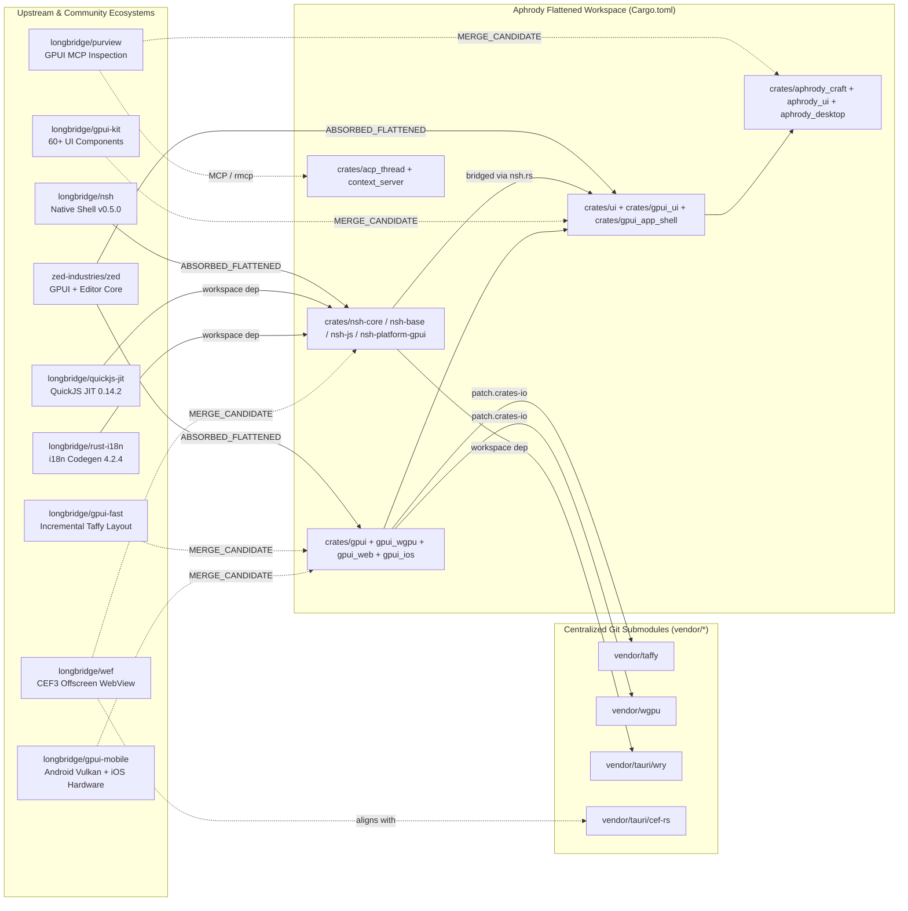

# Longbridge, Zed & Community GPUI Unification Architecture

> Canonical, reproducible deduplication, dependency centralization, Graphify topology, feature-matrix audit, and live ecosystem verification for unifying upstream [`zed-industries/zed`](https://github.com/zed-industries/zed), [`longbridge`](https://github.com/orgs/longbridge/repositories) GPUI/NSH repositories, and community GPUI crates onto the flattened [`aphrody`](../../Cargo.toml) core.

---

## 1. Automated Ingestion & Verification Pipeline

All telemetry in [`assets/os/longbridge_gpui_inventory.toml`](../../assets/os/longbridge_gpui_inventory.toml), `target/longbridge-ingest/graph.json`, `target/longbridge-screenshots/*.png`, and the synchronized sections below is generated by [`tooling/bun/longbridge-ingest.ts`](../../tooling/bun/longbridge-ingest.ts) and verified by [`tooling/bun/longbridge-ingest.test.ts`](../../tooling/bun/longbridge-ingest.test.ts):

```bash
bun tooling/bun/longbridge-ingest.ts scan        # Live Longbridge (100+ repos) + Zed + Community GPUI + crates.io/npm scan
bun tooling/bun/longbridge-ingest.ts graph       # cargo metadata feature matrix + Graphify JSON + Mermaid + TOML inventory
bun tooling/bun/longbridge-ingest.ts centralize  # Workspace dependency, [lints], [patch.crates-io], and duplicate crate audit
bun tooling/bun/longbridge-ingest.ts sitemaps    # Live sitemap.xml + internal route crawler across GPUI/NSH/Zed docs
bun tooling/bun/longbridge-ingest.ts screenshots # Headless Chromium/Edge CDP PNG captures in target/longbridge-screenshots/
bun tooling/bun/longbridge-ingest.ts all         # Full end-to-end ingestion refresh
```

### Live Verified Telemetry Snapshot

<!-- BEGIN LONGBRIDGE_INGEST_METRICS -->
| Telemetry Dimension | Live Verified Count / Value | Source / Audit Path |
| :--- | :--- | :--- |
| **Longbridge Org Repos Scanned** | `103` repos (`5` absorbed, `12` merge candidates, `29` ref/bench/showcase, `57` infra) | `gh api --paginate orgs/longbridge/repos` |
| **Community GPUI Repos Tracked** | `22` repositories | GitHub Search + `crates.io` |
| **Aphrody Workspace Crates** | `301` members (`61` core GPUI/NSH/OS crates in feature matrix) | `cargo metadata --format-version 1` |
| **Cargo Dependency Centralization** | `63` non-workspace dep entries across `61` unique deps; `1` crates missing `[lints] workspace = true` | Root [`Cargo.toml`](../../Cargo.toml) + member manifests |
| **Resolved Graph Duplicates** | `177` crates with >1 resolved version (`177` major.minor splits) | `target/longbridge-ingest/graph.json` |
| **Live Sitemaps & Screenshots** | `12` showcase/docs sites (`5987` discovered URLs), `6/6` validated PNG captures | `target/longbridge-screenshots/*.png` |
<!-- END LONGBRIDGE_INGEST_METRICS -->

---

## 2. Deduplicated Graphify Topology

<!-- BEGIN LONGBRIDGE_INGEST_MERMAID -->


> Graphify snapshot: **419** deduplicated nodes, **558** typed edges, **19** merge candidates, **177** multi-version crates (**177** major.minor splits).
<!-- END LONGBRIDGE_INGEST_MERMAID -->

---

## 3. Repository Classification & Deduplication Matrix

### 3.1 Already Absorbed & Flattened (`ABSORBED_FLATTENED`)

| Upstream Repository | Local Aphrody Anchor | Integration & Centralization State |
| :--- | :--- | :--- |
| `zed-industries/zed` | [`crates/gpui/Cargo.toml`](../../crates/gpui/Cargo.toml), `crates/ui`, `crates/editor`, `crates/zed` | Base workspace flattened into [`Cargo.toml`](../../Cargo.toml) (`301` members, `20` excluded submodules in [`.gitmodules`](../../.gitmodules)). |
| `longbridge/nsh` | [`crates/nsh-core/Cargo.toml`](../../crates/nsh-core/Cargo.toml), [`crates/nsh-platform-gpui/Cargo.toml`](../../crates/nsh-platform-gpui/Cargo.toml), [`crates/gpui_ui/src/nsh.rs`](../../crates/gpui_ui/src/nsh.rs) | Flattened directly as `crates/nsh-*` (`0.5.0`, Edition 2024, Rust `1.97`) with live `gpui_ui` theme & `AppView` embedding bridge. |
| `longbridge/native-shell-v1` | `crates/nsh-core`, `crates/nsh-engine` | Gen-1 Native Shell superseded and retired into `crates/nsh-*` v0.5.0. |
| `longbridge/quickjs-jit` | [`Cargo.toml`](../../Cargo.toml) (`rquickjs`, `quickjs-jit-stdlib`), `crates/nsh-js` | Centralized at `=0.14.2` in `[workspace.dependencies]` (`quickjs-jit-sys` built at `opt-level = 3`). |
| `longbridge/rust-i18n` | [`Cargo.toml`](../../Cargo.toml) (`rust-i18n`, `rust-i18n-support`), `crates/nsh-i18n` | Centralized at `4.2.4` in `[workspace.dependencies]`. |
| `longbridge/wry` | [`.gitmodules`](../../.gitmodules) (`vendor/tauri/wry`), [`Cargo.toml`](../../Cargo.toml) (`wry`) | Single path submodule checkout `vendor/tauri/wry` referenced via `[workspace.dependencies]`. |

### 3.2 Priority Merge Candidates (`MERGE_CANDIDATE`)

| Upstream / Community Repo | Target Aphrody Crates | Technical Gap & Merge Plan |
| :--- | :--- | :--- |
| `longbridge/gpui-fast` | [`crates/gpui/src/taffy.rs`](../../crates/gpui/src/taffy.rs), `tooling/perf` | Local `TaffyLayoutEngine::clear()` still clears the entire `TaffyTree` every frame; adopt dirty-tracking layout retention & `gpui_perf` microbenchmarks. |
| `longbridge/gpui-kit` | `crates/ui`, `crates/gpui_ui`, `crates/aphrody_ui` | Reconcile 60+ GPUI desktop widgets (`gpui-kit` / `gpui-component` 0.10.0), virtualized tables, dock, and `fps` monitor without duplicating `nsh-base` primitives. |
| `longbridge/gpui-mobile` | [`crates/gpui_ios/Cargo.toml`](../../crates/gpui_ios/Cargo.toml), `crates/nsh-platform-android`, `crates/gpui_platform` | Port Android Vulkan surface lifecycle and unified mobile device/hardware features from `gpui-pre-mobile` onto centralized `gpui_platform`. |
| `longbridge/wef` | `crates/nsh-platform-gpui`, `vendor/tauri/cef-rs`, `crates/aphrody_desktop` | Evaluate offscreen CEF3 rendering (`wef 0.6.0`, `gpui-webview 0.10.0`) alongside `vendor/tauri/cef-rs` for consistent embedded web surfaces. |
| `longbridge/purview` | [`crates/aphrody_craft/src/mcp.rs`](../../crates/aphrody_craft/src/mcp.rs), `crates/inspector_ui`, `crates/gpui_ui` | Adopt structured semantic multi-window GPUI projection over `rmcp` so AI agents inspect and drive live GPUI windows without screenshot guessing. |
| `longbridge/longbridge-ai-acp` & `acp-registry` | `crates/acp_thread`, `crates/acp_tools`, `crates/agent_servers` | Align ACP auth/rich-content contracts with root `agent-client-protocol =5.3.0`. |
| `longbridge/longbridge-mcp` & `longbridge-terminal` | `crates/aphrody_craft`, `crates/context_server`, `crates/terminal_view`, `crates/nsh-platform-tui` | Harmonize streamable-HTTP `rmcp` servers and Ratatui/CLI release packaging profiles. |
| Community GPUI Libs (`gpui-ce`, `gpui-motion`, `gpui-rsx`, `native-theme`, `gpuix`) | `crates/gpui`, `crates/ui`, `crates/gpui_ui`, `crates/aphrody_ui` | Harvest native OS theming, spring/motion presets, RSX ergonomics, and JS/TS host bindings without introducing duplicate `gpui` versions. |

---

## 4. Cargo Workspace Centralization & Dependency Hygiene

[`tooling/bun/longbridge-ingest.ts`](../../tooling/bun/longbridge-ingest.ts) mirrors and extends [`tooling/xtask/src/tasks/package_conformity.rs`](../../tooling/xtask/src/tasks/package_conformity.rs) across all workspace members, including `[target.<cfg>.dependencies]` and resolved `cargo metadata` version graphs:

1. **Workspace Lints (`[lints] workspace = true`)**: Flag any member missing workspace lint inheritance (currently `perf` in `tooling/perf`).
2. **Non-Workspace Dependency Elimination**:
   - **Already in root `[workspace.dependencies]`**: Migrate direct declarations in `compliance`, `edit_prediction_*`, `etw_tracing`, `fs`, `gpui`, `gpui_apple`, `gpui_linux`, `gpui_windows`, `rpc`, `vim`, `xtask` to `.workspace = true`.
   - **Direct `git` dependencies outside `[workspace.dependencies]`**: Move `etw_tracing` (`wprcontrol`), `fs` (`trash`), `gpui_linux` (`xim`), and `vim` (`nvim-rs`) into root [`Cargo.toml`](../../Cargo.toml) for single-revision pinning.
   - **Remaining uncentralized versions**: Hoist core `gpui` / `gpui_linux` / `gpui_shared_string` / `ztracing` dependencies (`num_cpus`, `parking`, `seahash`, `lyon_path`, `tiny-skia-path`, `smol_str`, `wayland-*`, `calloop`, `tracy-client`) into `[workspace.dependencies]`.
3. **Resolved Graph Duplicate Reduction**: See [Production Guide](./production-guide.md) and `target/longbridge-ingest/graph.json` (`duplicatePackages`) for top multi-version splits (`hashbrown`, `itertools`, `quick-xml`, `rand*`, `windows*` at 5x; `darling*`, `toml_edit`, `wasm-*` at 4x).

---

## 5. Live Showcase Sitemap & Screenshot Verification

The `sitemaps` and `screenshots` commands verify live ecosystem documentation and app directories (including `https://nsh.dev`, `https://nsh.dev/apps`, `https://gpui-kit.com`, `https://gpui-kit.com/apps/`, `https://zed.dev`, and `https://longbridge.github.io/purview/`):

- XML `<urlset>` / `<sitemapindex>` crawling + same-origin `<a href>` route extraction with per-URL HTTP status tolerance.
- Real headless Chromium/Edge CDP `1280x800` PNG captures stored under gitignored `target/longbridge-screenshots/*.png` with PNG IHDR signature and dimension verification.
- See [Architecture Index](./README.md) for sibling subsystem guides and [`assets/os/longbridge_gpui_inventory.toml`](../../assets/os/longbridge_gpui_inventory.toml) for the complete machine-readable catalog.
